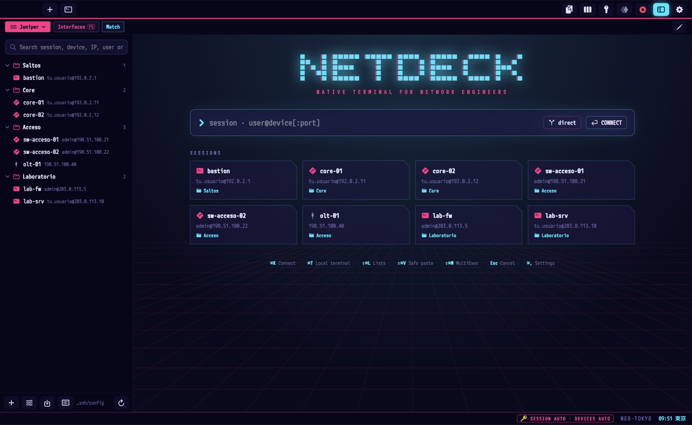
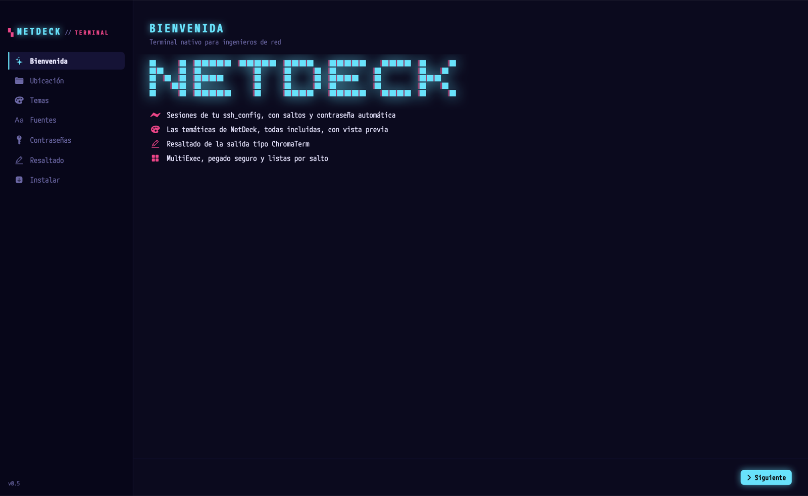
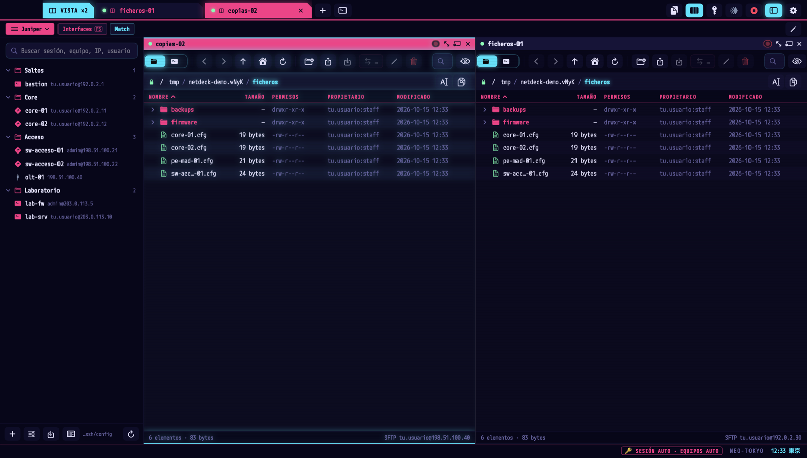
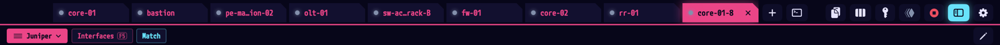
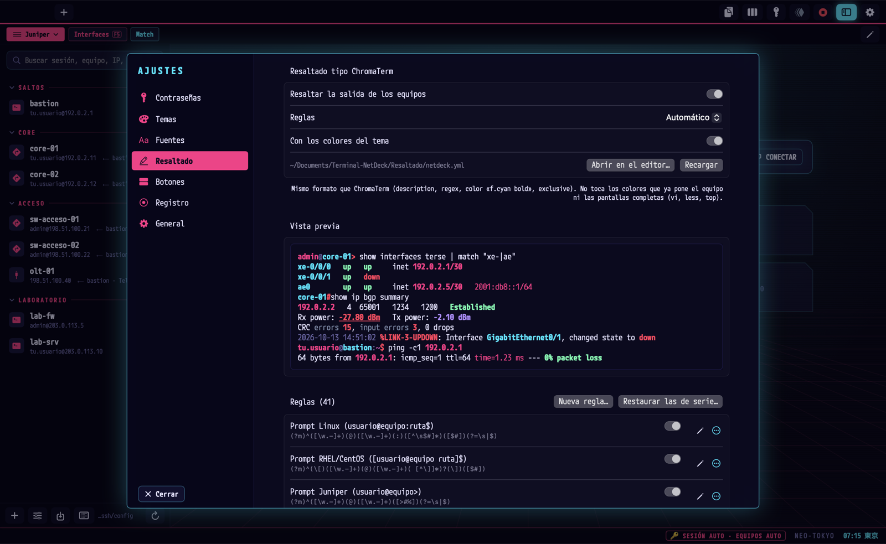
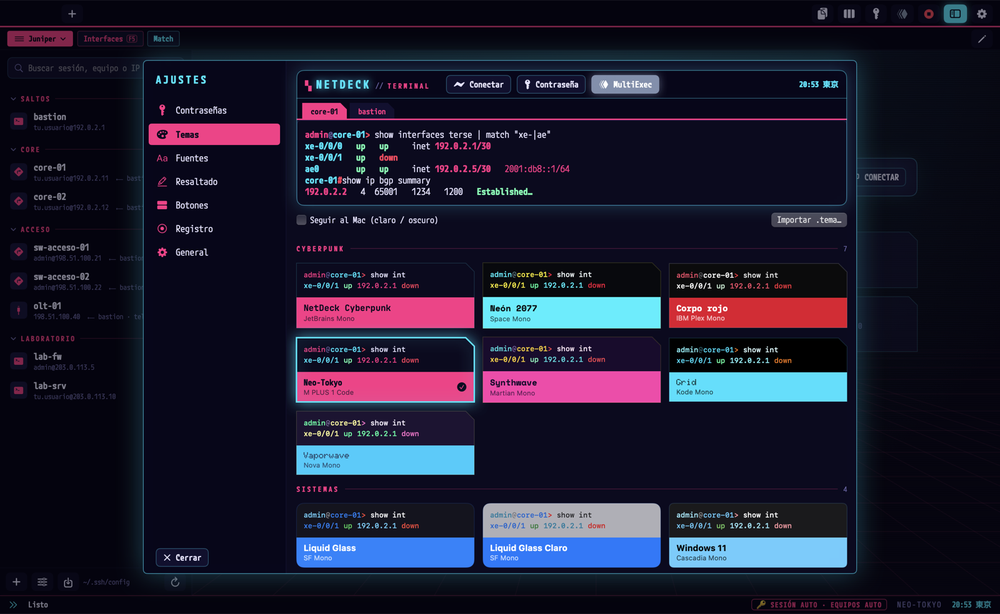
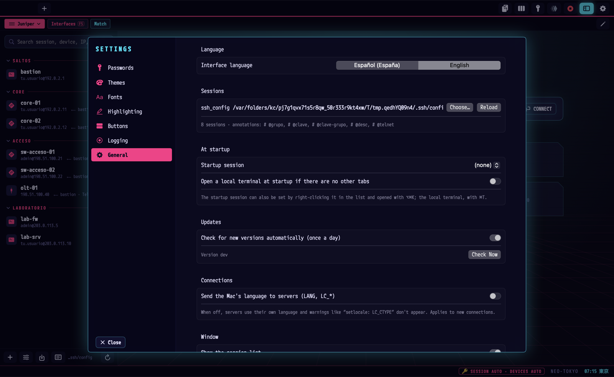

<div align="center">

# Terminal NetDeck

**The macOS terminal for people who live among routers, switches and jump hosts.**

Sessions with jump hosts, passwords that never end up on the wrong device, MultiExec, an SFTP/FTP browser
and 51 themes. Native, fast and in your language.

[](https://github.com/Iljonis/Terminal-NetDeck/releases/latest)

Current version: **[v0.9.7](https://github.com/Iljonis/Terminal-NetDeck/releases/tag/v0.9.7)** · macOS 15 or later ·
open source (MIT)

[](https://github.com/Iljonis/Terminal-NetDeck/releases/tag/v0.9.7)
[](https://github.com/Iljonis/Terminal-NetDeck/actions/workflows/tests.yml)
[](LICENSE)
[](https://www.swift.org)
[](https://www.apple.com/macos/)

[Español](README.md) · **English**



</div>

## Why Terminal NetDeck

If you run a network, your day means opening twenty sessions behind a jump host, typing the same password again and
again, pasting configs while dreading a `reload`, and moving files between servers. Terminal NetDeck brings all of
that into one macOS app, built around one idea: **it should never play a trick on you.**

- Your sessions are the ones in your `ssh_config`: `ssh core-01` keeps working from any other terminal.
- Passwords live only in the Keychain and are only typed for the user and the device that really ask for them.
- When something goes wrong (a password fails, a server stops answering, a copy breaks off), the app stops, tells
  you, and never leaves anything half done.

## Key features

- **Output highlighting** for Cisco, Juniper, Huawei, Nokia SR-OS and Linux: IPs, interfaces, states, BGP, alarms.
- **SFTP/FTP browser** with atomic copies, built-in MD5 verification and server-to-server transfers.
- **Multi-tab** with split view, MultiExec and safe paste; **51 themes** with WCAG contrast.
- **Sessions with jump hosts** on top of your `ssh_config`, passwords only in the macOS Keychain.

### New in 0.9.7

- **Password buttons always work:** password and login buttons and the 🔑 menu also type when the session asks for
  its password while connecting. Login only types it when the prompt is for its own user.
- **Command buttons explain themselves:** at a password prompt they type nothing and say why.
- **Split view:** the keyboard stays on the pane you click, so autopass and buttons (F5… too) act on that pane.
- **15-minute block only for the default password** auto-typed after ssh/telnet from a session. Saved sessions and
  what you type with buttons or 🔑 no longer block; if a saved one fails, you are asked for it.

### New in 0.9.6

- **Autopass with history and Tab:** recognizes the SSH/Telnet command selected with Enter from the same prompt,
  including return visits and other tabs. A `show run` or banner cannot start a login.
- **No lost autopass attempts:** rechecks the same request when output arrives during a Keychain lookup and resumes
  after another tab confirms the password; Escape and rejection blocks still stop it.
- **Background Keychain access:** synchronous operations leave Swift's task workers available while waiting.
- **Editable credential manager:** change the name, or user and device, without re-entering the password. Renaming
  updates assignments and preserves failure blocks; recoverable entries are kept if an update fails.
- **Clearer assignments:** choose a named credential, inherit the group's, or use the device's own. You can create
  a credential from the session editor. The default shows its exact user and missing entries.
- **Searchable Keychain catalog with reload**, without main-thread lookups or silent overwrites when adding entries.

- **Multiple windows:** ⌘N opens another; tabs move between windows by dragging or from the context menu, without
  dropping the connection. Each window comes back with its tabs and position when reopened.
- **Rename a tab** (right click): the name stays while you remain on that device, including after reconnecting.
- **Export and import buttons** in Settings → Buttons to share them; passwords never travel.
- **More precise passwords:** saved sessions use their own password and each jump host's without waiting for other
  tabs; on devices opened from a session, help only starts when you send an SSH/Telnet command, never from a
  `show run`, a banner or a log.
- **Tunnels and device lists** are sturdier when processes exit and with per-jump credentials.
- **Full screen:** fixed the extra top gap and the tab bar covering session search and the terminal's first line.

### New in 0.9.3

- **Full tab bar:** width comes from the window, avoiding a collapsed strip that shows only one tab. Controls stay fixed at the top right.
- **Fixed tab mouse handling:** selection and closing use normal AppKit event delivery, with gestures
  for dragging across the tab body while keeping the window still. The close button keeps its 24 × 24 target.
- **Complex Keychain passwords:** passwords with ñ, €, º, accents or “\\” were typed wrong (macOS returned them
  in hex) and an AD account was locked for 15 min; they are now typed exactly as saved.
- **Distribution package validation:** functional checks run against the `.app` built for distribution, require
  actual selection changes, closes and reordering, and fail on skipped cases or missing reports.
- **Automation and files:** MultiExec honours macro reservations at every destination; remote editing publishes
  copies without replacing another and retries pending saves after reconnecting.

- **SFTP beside SSH:** same host, configuration and jumps; panel width remembered per session.
- **Remote editing:** text files up to 5 MB, remote version checks, conflict choices and separate copies.
  Open local copies are preserved after closing a tab under `~/Library/Application Support/Terminal NetDeck/edicion/`.
  Over SFTP the upload only replaces the file if it is still as downloaded. Over FTP the server can't guarantee it won't
  overwrite a file that appears meanwhile: the local copy is preserved unless you confirm "Overwrite".
  "Save as copy" requires exclusive publication support (SFTP).
- **Workspaces:** save tab order, selection, SFTP panels and split proportions. Add tabs or replace the window after
  confirmation. Missing sessions are reported; loopback and manually typed jumps are excluded. MultiExec stays off;
  no macros or tunnels start automatically.
- **Macros:** record/edit/replay commands, wait for prompts or text, add pauses. Playback stops at errors, pagers or
  secret requests. Recording skips commands when their initial prompt cannot be safely recognised, including
  fragmented pastes. Never put secrets in commands or macros.
- **SSH tunnels:** local, remote and SOCKS with explicit start/stop and status. Loopback by default; exposing a
  listener requires explicit selection. Configurations with inherited forwards are rejected to prevent hidden
  listeners. Remote listening also depends on GatewayPorts and server permissions.
- **Session profiles:** font, size, theme, scrollback, keyboard and prompt annotations in ssh_config; unspecified
  values inherit Settings. Connect without saving applies the form's profile to that tab only. User regex matching
  is bounded and cannot treat authentication failures or password/OTP requests as valid prompts.
- **Native serial:** framing is applied and checked, closing cancels pending output, and Terminal → Send BREAK
  sends a native break. Specific USB adapters still require hardware testing.
- **Tabs:** whole-tab dragging and a highlighted 24 × 24 point close target.
- **Update recovery:** preserves staging and the previous app even if restoration fails. Backups include macros,
  tunnels, workspaces and SFTP panel state. If that backup can't be made (an unreadable file, no backup folder),
  nothing is installed or updated: the previous app stays as it was and you're told why.

## Requirements & compatibility

- macOS Sequoia (15.0) or later.
- To build from source: Swift 6 (Xcode or Command Line Tools).

## Installation & First Run on macOS 15 (Sequoia)

1. **Download** `Terminal-NetDeck.dmg` from the [latest release](https://github.com/Iljonis/Terminal-NetDeck/releases/latest).
2. **Open it** and drag **Terminal NetDeck** to **Applications**.
3. **Allow the app once.** The app ships with an *ad hoc* signature and is not notarized. The recommended method is
   to remove the quarantine attribute from Terminal:

   ```bash
   sudo xattr -cr "/Applications/Terminal NetDeck.app"
   ```

   > **Graphical alternative:** open the app once and, after the macOS warning, go to **System Settings → Privacy &
   > Security → Open Anyway**.

4. **Open it.** The setup assistant configures sessions, theme, font, passwords and highlighting.

Updates from the app itself and installs with `./install.sh` don't need this step.

Your data stays on your Mac: settings in `~/Library/Application Support/Terminal NetDeck/`, sessions in `ssh_config`
format and passwords only in the macOS Keychain. Updating only replaces the app: your sessions, `~/.ssh/config`,
buttons and lists are first backed up to `~/Library/Application Support/Terminal NetDeck/copias/`, and if the sessions
file or its `Include` were ever missing at launch, the app restores them on its own.



### Keeping it up to date

- **From the app itself.** Once a day it quietly checks for a new version. If there is one, a discreet notice shows
  up in the status bar: click **Update now** and it downloads, verifies it (the sha256 GitHub publishes, plus its
  signature) and reopens with your tabs. Nothing is ever installed without that click.
- **From the source, in a moment:**

  ```bash
  cd Terminal-NetDeck
  git pull
  ./actualizar.sh        # builds, replaces the app and reopens it with your tabs
  ```

<details>
<summary><b>Install from source</b> (macOS 15+ and Swift 6)</summary>

```bash
xcode-select --install          # if you have neither Xcode nor the Command Line Tools
git clone https://github.com/Iljonis/Terminal-NetDeck.git
cd Terminal-NetDeck
./install.sh                    # builds it and installs it in /Applications (or ~/Applications)
```

| Command | What for |
|---|---|
| `./install.sh --usuario` | Install it in `~/Applications` |
| `./install.sh --dmg` | Build `dist/Terminal-NetDeck.dmg` |
| `./install.sh --asistente` | Open the setup assistant without installing (to try it) |
| `./install.sh --fuente "Kode Mono"` | Install a font with Homebrew |
| `./desinstalar.sh [--todo]` | Remove the app (`--todo`: themes and settings too; the Keychain is never touched) |

</details>

## What it does for you

### 🔐 Passwords that never go to the wrong place

- **Only in the macOS Keychain:** never in files, arguments or logs.
- **Saved sessions open directly:** SSH/SFTP use their assigned password and each jump host’s own credential, without guessing or waiting for other tabs. Telnet starts manually.
- **Devices opened from a session:** help is armed only by an SSH/Telnet command you send, then ends on login, cancellation or another command. `show run`, `show config`, banners and logs never activate it. Suggest mode offers compatible credentials in a small selector tied to that tab and login.
- **Strict user rule:** a password is only typed automatically when it belongs to exactly the user being asked for.
- **And the right device:** a server that prints a fake `admin@core-01's password:` doesn't get core-01's password;
  only that tab's destination and jump hosts count.
- **If the default credential, typed automatically, fails, it is not typed automatically again for 15 minutes** in any
  tab, so your Active Directory account doesn't get locked out. Saved sessions' passwords are not locked (if one
  doesn't work, you are asked for it), and whatever you choose — 🔑 menu or a button — is always typed.
- **The Keychain never freezes the app:** it's read in the background, with a 10-second limit.
- 🔑 menu to type any of them by hand, even at odd prompts the app doesn't recognise.

In **Settings → Passwords**, click **Add…** and choose **Named** (for example, “Main network”) or **User and device**.
**Edit…** lets you change the name or account and optionally replace its password; leave both password fields empty
to keep it. Adding an entry cannot overwrite an existing name. **Reload** picks up changes made in Keychain Access.

In **Sessions → Session credential**, choose a stored name, **Inherit from group**, or **Device credential (ignore
group)**. **Uses:** shows the effective assignment. **New named credential…** creates it in Keychain and selects it
in the draft; click **Save** to keep the assignment. Each jump host uses its own session's credential.

Select the **Default credential** in Passwords together with its **Exact user**: it is a fallback for devices opened
from a session. Choosing **None (ask)** or clearing the user disables it. A saved session's initial login uses its
own assignment without falling back to the default.

Renaming updates sessions, groups, buttons, lists and the default. If an external configuration still uses the old
name, the app keeps that entry and tells you. External files are not rewritten; secrets stay only in macOS Keychain.

### 🛡️ Jump hosts without surprises

- Your sessions with chained `ProxyJump`, and telnet through the jump host.
- **A single connection to the bastion:** tabs that go through the same jump host share it (like SecureCRT; kept
  open for 2 min after the last one closes) and don't authenticate on it again. Turn it off in Settings → General → Connections.
- **Hardened manual hop:** if a jump host refuses forwarding (`-J`), the app asks before logging into it, and the
  destination password is only suggested, never typed automatically through the jump host's shell.
- **No injections:** a host or user starting with `-` never reaches ssh as an option, every command puts `--` before
  the destination, and imported sessions only keep safe ssh options (no `ProxyCommand`, no `Host *` blocks, no port
  forwarding…).

### 📂 An SFTP/FTP browser with file protection

- Tree and list with sizes, permissions, owner and date; upload by dragging from the Finder, download, rename, delete.
- **Atomic copies:** files are written to a temporary file first and only replace the real one at the end. A copy that
  fails or that you cancel never leaves anything half written nor deletes the original, and its permissions are kept.
- **MD5 integrity:** each file is read back from the destination and its MD5 must match the source's.
- **Server to server** ("Send to…"), SFTP ↔ SFTP or SFTP ↔ FTP, in memory and without touching the Mac's disk.
- **Cancel is instant**, and a server that stops answering is cut off after 30 seconds instead of hanging the window.



### ⚡ Working on many devices at once

- **MultiExec** and **split view:** what you type goes to several panes at once (exclude the ones you want).
- **Safe paste:** line by line, waiting for the prompt; it stops on CLI errors, pagers, unconfirmed dangerous commands
  (`reload`, `delete`…) or a password prompt.
- **Device lists:** the same command on many devices behind a jump host, trying the password one device at a time.
- **Button bar** with categories, F1–F12 keys and placeholders like `{{vlan=100}}`. Settings → Buttons **exports**
  them to a `.txt` to hand to a colleague and **imports** theirs (merged with yours without duplicates, or replacing
  them). Passwords never travel: only the name they're saved under in the Keychain.

### 🗂️ Tabs that adapt

- They share the window's width and, when they don't fit, scroll while keeping the active one in view.
- The title is just the **destination device** (`core-02`, not `core-02 ⟵ bastion`); the full path shows on hover.
  If you hop from a session to another device, the tab shows it.
- The bar's buttons never get pushed out of the window, however many tabs you have.
- Dragging a tab never moves the window, also when the window is set to “Fill”.
- **Rename a tab** (right-click): your name stays while you're on that device (also after reconnecting) and the
  device name comes back when another device's prompt shows up.
- **Several windows:** ⌘N opens another one. Drag a tab out of its window to take it to another screen (a window opens
  there with it) or onto another window's tab bar; or right-click → “Move to New Window” / “Move to Window”. The
  connection carries on as it was, without reconnecting. On quit each window is saved with its tabs and position,
  and they come back that way. Closing a window with open connections asks first; the last one quits the app as
  always.



### 🧰 And also

- **Session types:** SSH, Telnet, SFTP, FTP, local shell and serial console (speed, data bits, parity and stop bits applied and checked).
- **Session manager** with folders (`Clients/Madrid/Core`), favourites, recents and a **Connect** button to try one
  without saving.
- **Import** from SecureCRT, MobaXterm, PuTTY, electerm, CSV or another `ssh_config`; **export** to JSON or CSV.
  Never passwords.
- **ChromaTerm-style output highlighting** (IPs, MACs, interfaces, states, BGP, dBm, errors…) for Cisco, Juniper,
  Huawei, Nokia SR-OS (classic and MD-CLI prompts, `1/1/c1/1` ports, alarms) and Linux, in the theme's colours,
  editable with a live preview. You can pick the shade of each highlight colour, per theme, without touching the
  interface; if you have your own rules, each release's new ones are added with one click.
- **Rectangular selection:** hold ⌥ and drag to copy just some columns (the IPs of a `show ip interface brief`,
  without the rest of the line).
- **Configurable scrollback:** 2,500 lines per tab by default; 1,000, 5,000 or 10,000 in Settings → Terminal.
- **Session logging** to clean text and **search** across all logs (IPs, MACs in any format…).
- **No locale warnings** on Linux servers: ssh doesn't send the Mac's language unless you turn it on.
- **Spanish (Spain) and English**, switched instantly in Settings → General → Language.



## 🎨 51 themes for every shift

From a 3 a.m. NOC shift to a presentation on a projector. Each one has its ANSI palette and font, can **follow the
Mac's light or dark mode**, and **every theme passes a WCAG contrast test** (text ≥ 4.5:1). Want your own? Copy a
`.tema` file from `Temas/`, change the colours and import it. There's also the built-in one, **NetDeck Cyberpunk**.



<details>
<summary><b>See the full catalogue</b></summary>

| Group | Theme | What it looks like |
|---|---|---|
| **Cyberpunk** | **Cyber Neón** | Electric yellow, cyan and neon red on black. |
|  | **Corpo rojo** | Black, corporate red and white. Understated, with kanji labels. |
|  | **Neo-Tokyo** | Japanese cyberpunk: deep indigo, magenta and cyan. |
|  | **Synthwave** | Retrowave sunset: pink, violet and orange. |
|  | **Grid** | Pure black with electric cyan and orange (Tron style). |
|  | **Vaporwave** | Turquoise and pastel pink on violet, nineties aesthetic. |
| **Systems** | **Liquid Glass** | Like macOS 27: transparent, blurred glass with the system colours. |
|  | **Liquid Glass Claro** | macOS 27 by day: light blurred glass, crisp dark text. |
|  | **Windows 11** | Fluent and Mica: translucent dark grey, blue accent, Cascadia Mono and the Campbell palette. |
|  | **Windows 11 Claro** | Fluent by day: light Mica, blue accent and the "One Half Light" palette. |
| **Anime & film** | **Unidad-01** | Purple and neon green, warnings in orange (EVA-01 style). |
|  | **Unidad-02** | Intense red and orange with lime green (EVA-02 style). |
|  | **Neo-Tokio rojo** | Motorbike red, black and white with kanji (Akira style). |
|  | **Fantasma rojo** | Red, black and white with brutal contrast (Persona 5 style). |
|  | **Replicante** | Orange haze and petrol blue (Blade Runner style). |
|  | **Sección 9** | Sea green and white on slate (Ghost in the Shell style). |
|  | **Bosque** | Moss greens, sky and warm tones (Ghibli style). |
|  | **Andén** | Orange LED board of a Japanese train station. |
| **Kawaii** | **Kawaii futurista** | Dark lavender, pink, mint and lilac. ♡ ✧ touches. |
|  | **Sakura** | Light and soft, for a white background. |
|  | **Alba rosa** | Light dawn tones: cream, old rose, iris and pine (inspired by Rosé Pine Dawn). |
| **Retro** | **Fósforo** | Classic green phosphor monitor. |
|  | **Ámbar** | 80s amber terminal, warm for long hours. |
|  | **Otoño retro** | Warm with little blue, inspired by Gruvbox: good for night work. |
|  | **Monokai** | The editor classic: bright green, yellow and pink on olive grey. |
|  | **Trigo** | Cream paper with toasted ink (inspired by Gruvbox light): daytime partner of Otoño retro. |
| **Subdued** | **Ártico** | Understated but contrasted: ice, aurora and amber. |
|  | **Medianoche** | Soft blues and violets (Tokyo Night style). |
|  | **Vampiro** | Purple, pink and green on grey (Dracula style). |
|  | **Océano profundo** | Abyssal blue with aquamarine and coral highlights. |
|  | **Grafito** | Charcoal grey instead of black: no glare when switching from a light window. |
|  | **Solar oscuro** | The classic Solarized palette, dark: easy on the eyes for long shifts. |
|  | **Solar claro** | Solarized light: partner of Solar oscuro (ideal in Auto mode). |
|  | **Moca** | Soft pastels on a dark background, inspired by Catppuccin Mocha. |
|  | **Fiordo** | Arctic slate grey with frost blues (inspired by Nord): calm for long shifts. |
|  | **Café con leche** | Light and creamy (inspired by Catppuccin Latte): daytime partner of Moca. |
|  | **Gran ola** | Indigo ink, aged paper and Japanese woodblock blues (inspired by Kanagawa). |
|  | **Taiga** | Muted forest green with sage, sand and moss (inspired by Everforest). |
| **Practical** | **Accesible** | For colour blindness: good in blue, bad in orange. |
|  | **Alto contraste** | Pure white on black and colours at full strength. |
|  | **Pro** | macOS Terminal's "Pro" profile. |
|  | **Papel** | Light and very readable: bright offices, projectors or screen sharing. |
|  | **NOC** | For on-call screens: normal things muted, alarms jumping out. |
|  | **Guardia ámbar** | NOC console: amber on warm black, large type and unmistakable states. |
|  | **Guardia verde** | NOC console: soft green on black, alarms in red and warnings in amber. |
| **Corporate** | **DIGI** | DIGI Mobil blue (#1275B7) and the logo's red dot, on navy. |
|  | **Oracle** | Oracle red (#C74634) on Redwood's warm grey (#312D2A). |
|  | **Cisco** | Cisco blue (#049FD9) on night blue, with Cisco's status colours. |
|  | **Juniper** | Juniper green (#84B135) and lime (#CCDB2A) on slate grey. |
|  | **Huawei** | Huawei red (#CF0A2C) and its black (#232527). |
|  | **Ubuntu** | Ubuntu orange (#E95420) on aubergine (#300A24), like its terminal. |

</details>

## Gallery

| | |
|---|---|
|  **Home:** your sessions one click away, plus quick connect |  **SFTP browser** in split view |
|  **Theme gallery** with live preview |  **Editable highlighting rules** |
|  **Settings → Terminal:** scrollback and rectangular selection |  **First-run assistant** |


## Shortcuts

| Shortcut | What it does |
|---|---|
| ⌘K | Connect (a session or `user@host[:port]`, direct or through a jump host) |
| ⌘T | New local terminal |
| ⌘N | New window |
| ⇧⌘W | Close the window (asks if it has connections and there are more windows) |
| ⌥⌘K | Open the startup session |
| ⇧⌘E | Session manager |
| ⇧⌘L | Device lists |
| ⇧⌘V | Safe paste |
| ⇧⌘M | MultiExec |
| ⌘F / ⇧⌘F | Find in the output / in all logs |
| Esc or ⌘. | Stop any automated sequence |
| ⌥ + drag | Rectangular selection (just those columns); ⌘C copies it |
| ⌘, | Settings |

## Security and privacy

- Passwords only in the Keychain, with the user and device rules, and the default credential not typed automatically
  for 15 minutes after a failure.
- MultiExec and safe paste only reach SSH/Telnet tabs: never a local terminal, SFTP or serial console.
  A line is only broadcast if you start it at the device prompt, and only to tabs that are at theirs: whatever you type
  at a password, passphrase, OTP or any request that isn't a prompt stays in its tab. If a device has an unusual
  prompt, set it in the session profile (`# @prompt`).
- Your files (`ssh_config`, buttons, lists) are never overwritten when they can't be read, with a `.anterior` backup on
  every save; the app's folders and files are for your eyes only (0700/0600).
- A backup outside `~/.config/netdeck` before every update and every sessions save; a test checks on every change that
  updating leaves your sessions untouched.
- Updates only from github.com, checked against their sha256 and signature, and nothing is installed without your click.
- Ad hoc signature with the hardened runtime.
- Every change goes through a privacy check (nothing personal in the code, the app or the `.dmg`) and, every week, a
  dependency audit against the OSV.dev vulnerability database.
- Errors go to `~/Library/Application Support/Terminal NetDeck/logs/error.log` (Help → Open the error log), never with
  passwords.

## For developers

```bash
swift build
swift run TerminalNetDeck -idioma en   # in English
./test.sh                              # privacy check + update keeps your data + core tests
tools/capturas.sh                      # regenerates docs/capturas with sample data
tools/verificar_demo.sh                # functional pass on the demo before a commit or tag
```

| Module | Contents |
|---|---|
| `NetDeckCore/Sessions` | `ssh_config`, jump hosts, `ssh -J`, telnet through the jump host, importers |
| `NetDeckCore/Security` | Keychain, askpass, user rule, shared lock after a failure |
| `NetDeckCore/Remote` | SFTP and FTP, atomic copies with MD5, server to server |
| `NetDeckCore/Productivity` | Safe paste, MultiExec, device lists through a jump host, button bar |
| `NetDeckCore/Highlight` · `Themes` | ChromaTerm-style highlighting · `.tema` format and catalogue |
| `NetDeckCore/Support` | Paths, logs, updates, languages (`L("…")` + `Ingles.swift`) |
| `TerminalNetDeck` | The app (SwiftUI) |
| `Temas/` · `Resaltado/` | Theme catalogue and highlighting rules |

The code is written in Spanish (Spain) and the interface is translated into English. The project conventions
(translatable strings, sample data, passwords, security) and how review agents are used are in
[CLAUDE.md](CLAUDE.md). Tests run on GitHub Actions on every push. To propose changes or report a bug, see
[CONTRIBUTING.md](CONTRIBUTING.md).

## Support & contributing

- **Bugs and requests:** [GitHub Issues](https://github.com/Iljonis/Terminal-NetDeck/issues).
- **Contributing:** see [CONTRIBUTING.md](CONTRIBUTING.md).

## License

[MIT](LICENSE) © 2026 Jonay / Iljonis. Built with Swift 6, SwiftUI and [SwiftTerm](https://github.com/migueldeicaza/SwiftTerm).
Dependency licences and colour-palette attributions are in [THIRD_PARTY_NOTICES.md](THIRD_PARTY_NOTICES.md), which
also ships inside the app.

## Trademarks

Cisco, Oracle, Juniper, Huawei, DIGI, Ubuntu, Apple, macOS, Liquid Glass, Microsoft, Windows and every other company,
product, work or palette name mentioned in this project are trademarks of their respective owners. They are cited only
to describe colour combinations or compatibility (for example, "inspired by" or "style"). Terminal NetDeck is an
independent project: it is not affiliated with, sponsored or endorsed by any of them, and it includes none of their
logos or official assets.
