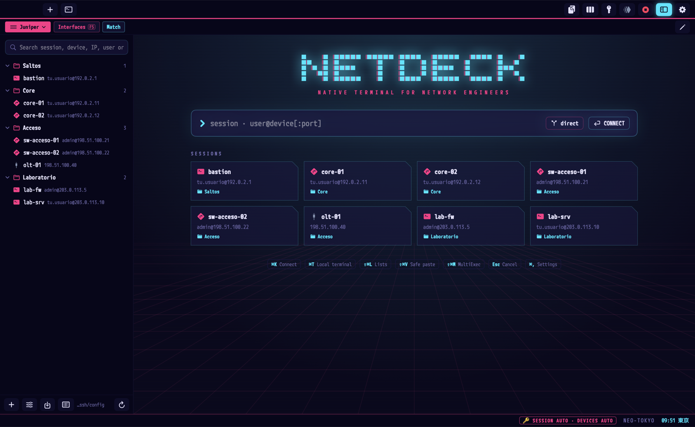
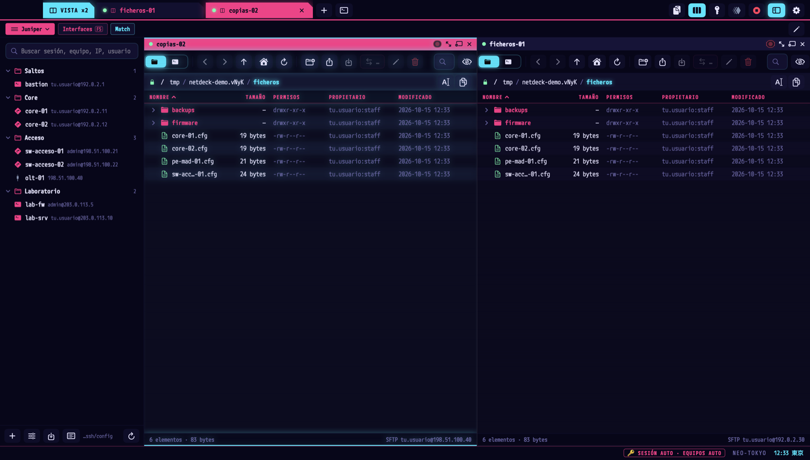
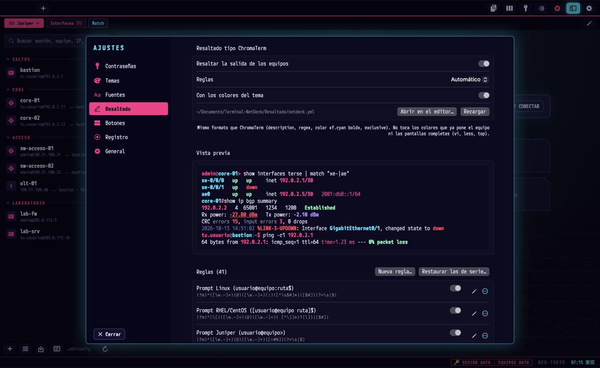
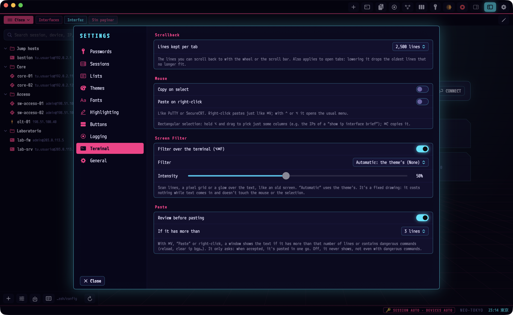
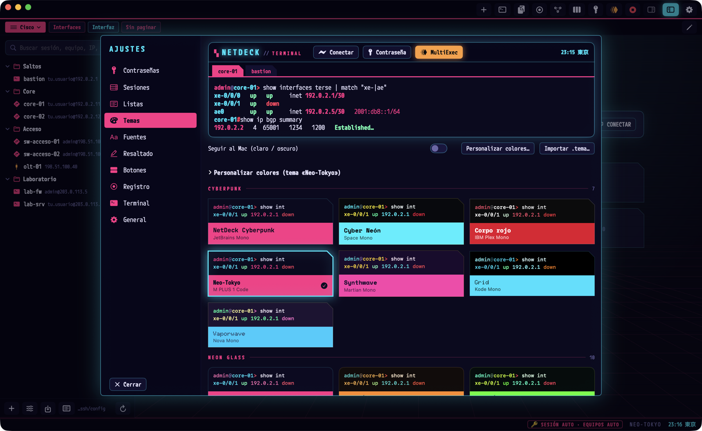
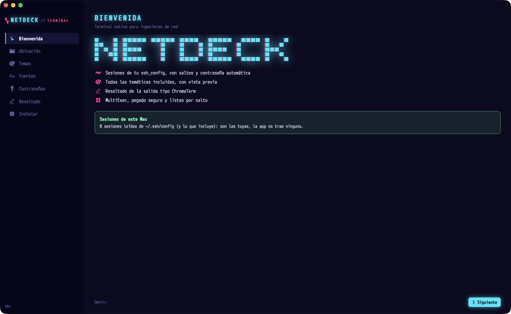

<div align="center">

# Terminal NetDeck

**The native macOS SSH terminal for people who live among routers, switches and jump hosts.**

Sessions with jump hosts on top of your `ssh_config`, passwords only in the Keychain, MultiExec with safe paste, an
SFTP/FTP browser and output highlighting for Cisco, Juniper, Huawei and Nokia. Free, open source, in English or Spanish.

[](https://github.com/Iljonis/Terminal-NetDeck/releases/latest)

Current version: **[v0.9.12](https://github.com/Iljonis/Terminal-NetDeck/releases/tag/v0.9.12)** · macOS 15 or later ·
open source (MIT)

[](https://github.com/Iljonis/Terminal-NetDeck/releases/latest)
[](https://github.com/Iljonis/Terminal-NetDeck/releases)
[](https://github.com/Iljonis/Terminal-NetDeck/actions/workflows/tests.yml)
[](LICENSE)
[](https://www.swift.org)
[](https://www.apple.com/macos/)

[Español](README.md) · **English**



[What's new](#new-in-0912) · [Features](#features-for-network-engineers) ·
[Comparison](#comparison-with-securecrt-mobaxterm-iterm2-and-royal-tsx) ·
[Install](#installation--first-run-on-macos-15-sequoia) · [Getting started](#getting-started) · [FAQ](#faq) ·
[Roadmap](#roadmap-to-100) · [Contributing](#contributing)

</div>

## Why Terminal NetDeck

If you run a network, your day means opening twenty sessions behind a jump host, typing the same password again and
again, pasting configs while dreading a `reload`, and moving files between servers. Terminal NetDeck brings all of
that into one macOS app, built around one idea: **it should never play a trick on you.**

- Your sessions are the ones in your `ssh_config`: `ssh core-01` keeps working from any other terminal.
- Passwords live only in the Keychain and are only typed for the user and the device that really ask for them.
- Before you paste a config or send a `reload` to ten devices with MultiExec, it shows you and asks.
- When something goes wrong (a password fails, a server stops answering, a copy breaks off), the app stops, tells
  you, and keeps whatever copies may need recovering.

## New in 0.9.12

- **Review before pasting:** pasting more than 3 lines (or anything with dangerous commands) opens a window to review
  the text. **Return** pastes and **Esc** cancels; it is pasted whole and in one go, as usual, so a full configuration
  goes in without limits. Turn it off or change the number of lines in **Settings → Terminal → Paste**. It does not
  show up while the device is asking for a password.
- **Safer MultiExec and buttons:** a `reload`, `clear ip bgp *` or `write erase` typed with MultiExec asks before it
  goes to several tabs, and buttons with dangerous commands ask for confirmation.
- **Better dangerous-command detection:** commands are checked from their start and without the prompt, including IOS
  abbreviations (`reloa`, `wr er`, `shu`) and Junos, Huawei, Nokia SR-OS and Linux commands. `show`, `no shutdown`,
  `clear counters` and `clear ip bgp * soft` no longer ask.
- **Finer highlighting:** IOS error counters in red only when not 0, BGP `Active`/`Idle` states in red, intentional
  shutdowns (`administratively down`, `Idle (Admin)`) in grey, IOS-XR and Huawei syslog, more interface types and
  fewer false positives. The interface rule is up to 5 times faster.
- **Colours show their real name:** in Settings and in the rule editor each colour shows the name of the colour you
  actually see in the theme (change «cyan» to green and it says «green»), with its swatch next to it.

Earlier versions, back to 0.5.0, are in the [CHANGELOG](CHANGELOG.md) and on the
[Releases page](https://github.com/Iljonis/Terminal-NetDeck/releases).

## Features for network engineers

### 🔐 macOS Keychain passwords that never go to the wrong device

- **Only in the macOS Keychain:** never in files, arguments or logs (except one you write into a button).
- **One list of named passwords**, like SecureCRT: pick “Main network” in a session, a group, a button or a device
  list, with **New…** next to every selector.
- **Saved sessions open directly:** SSH/SFTP use their assigned password and each jump host’s own credential, without
  guessing or waiting for other tabs. Telnet starts manually.
- **Strict user rule:** a password is only typed automatically when it belongs to exactly the user being asked for.
- **And the right device:** a server that prints a fake `admin@core-01's password:` doesn't get core-01's password;
  only that tab's destination and jump hosts count.
- **Your Active Directory account stays safe:** if the default credential, typed automatically, fails, it is not typed
  automatically again for 15 minutes in any tab (unless it got in less than 5 minutes ago: then the rejection comes
  from that device, and you type it just that once). Unlock it with one click in the bottom bar. Saved sessions'
  passwords are not locked (if one doesn't work, you are asked for it), and whatever you choose — 🔑 menu or a
  button — is always typed.
- **The Keychain never freezes the app:** it's read in the background, with a 10-second limit.

<details>
<summary><b>How passwords are picked and assigned</b></summary>

- **Devices opened from a session:** help is armed only by an SSH/Telnet command you send, then ends on login,
  cancellation or another command. `show run`, `show config`, banners and logs never activate it. Suggest mode offers
  compatible credentials in a small selector tied to that tab and login.
- 🔑 menu to type any of them by hand, even at odd prompts the app doesn't recognise.

**Settings → Passwords** is your list: each entry with its name (for example, “Main network”), where it is used,
**Change…** (name or password; leave the fields empty to keep it) and the bin. **New…** adds another; an existing
name is never overwritten. Older per-user-and-device entries still work, folded at the end.

In **Sessions → Password**, pick one by name, the group's, or **New…** to create it right there; **For the whole
group** assigns it to every session in the group. **Uses:** shows the one that will be used; click **Save** to keep
the assignment. Each jump host uses its own session's credential. If you type the session's password yourself and get
in, the app offers to save it (you can turn this off in Settings → Passwords).

Select the **Default credential** in Passwords together with its **Exact user**: it is a fallback for devices opened
from a session. Choosing **None (ask)** or clearing the user disables it. A saved session's initial login uses its
own assignment without falling back to the default.

Renaming updates sessions, groups, buttons, lists and the default. If an external configuration still uses the old
name, the app keeps that entry and tells you. External files are not rewritten; secrets stay only in macOS Keychain.

</details>

### 🛡️ SSH jump hosts and bastions without surprises

- Your sessions with chained `ProxyJump`, and telnet through the jump host.
- **A single connection to the bastion:** tabs that go through the same jump host share it (like SecureCRT; kept
  open for 2 min after the last one closes) and don't authenticate on it again. Turn it off in Settings → General →
  Connections.
- **Hardened manual hop:** if a jump host refuses forwarding (`-J`), the app asks before logging into it, and the
  destination password is only suggested, never typed automatically through the jump host's shell.
- **SSH tunnels:** local (`-L`), remote (`-R`) and SOCKS (`-D`), with status and explicit start and stop.
- **No injections:** a host or user starting with `-` never reaches ssh as an option, every command puts `--` before
  the destination, and imported sessions only keep safe ssh options (no `ProxyCommand`, no `Host *` blocks, no port
  forwarding…).

### ⚡ MultiExec, safe paste and device lists

- **MultiExec** and **split view:** what you type goes to several panes at once (exclude the ones you want). A
  `reload`, `clear ip bgp *` or `write erase` asks before it goes out to several tabs.
- **Review before pasting:** more than 3 lines, or anything dangerous, is shown before it is sent.
- **Safe paste:** line by line, waiting for the prompt; it stops on CLI errors, pagers, unconfirmed dangerous commands
  (`reload`, `delete`…) or a password prompt.
- **Device lists:** the same command on many devices behind a jump host, trying the password one device at a time.
- **Macros:** record, edit and replay commands, wait for the prompt or some text and add pauses.
- **Button bar** with categories, F1–F12 keys and placeholders like `{{vlan=100}}`. Settings → Buttons **exports**
  them to a `.txt` to hand to a colleague and **imports** theirs (merged with yours without duplicates, or replacing
  them). Passwords never travel: only the name they're saved under in the Keychain.

### 📂 Built-in SFTP and FTP client with atomic copies

- **Next to the SSH terminal:** the SFTP browser opens beside it, with the same host, user and jump hosts (⇧⌘B).
- Tree and list with sizes, permissions, owner and date; upload by dragging from the Finder, download, rename, delete.
- **Atomic copies:** files are written to a temporary file first and only replace the real one at the end. A copy that
  fails or that you cancel keeps the recoverable files and their permissions; if the server doesn't confirm the
  replacement, you're told which paths to check.
- **MD5 integrity:** each file is read back from the destination and its MD5 must match the source's.
- **Server to server** ("Send to…"), SFTP ↔ SFTP or SFTP ↔ FTP, in memory and without touching the Mac's disk.
- **Remote editing:** open a text file up to 5 MB in your editor; saving checks that nobody changed it on the server.



### 🌈 Output highlighting for Cisco, Juniper, Huawei and Nokia

- **ChromaTerm-style:** IPs, MACs, interfaces, states, BGP, dBm, error counters and syslog in colour, for Cisco IOS,
  IOS-XE and IOS-XR, Juniper Junos, Huawei VRP, Nokia SR-OS (classic and MD-CLI prompts, `1/1/c1/1` ports, alarms)
  and Linux.
- In the theme's colours and editable with a live preview. You can pick the shade of each highlight colour, per
  theme, without touching the interface; if you have your own rules, each release's new ones are added with one click.



### 🗂️ Tabs, split view and multiple windows

- Tabs share the window's width and, when they don't fit, scroll while keeping the active one in view.
- The title is just the **destination device** (`core-02`, not `core-02 ⟵ bastion`); the full path shows on hover.
  If you hop from a session to another device, the tab shows it.
- **Rename a tab** (right-click): your name stays while you're on that device (also after reconnecting) and the
  device name comes back when another device's prompt shows up.
- **Several windows:** ⌘N opens another one. Drag a tab out of its window to take it to another screen or onto
  another window's tab bar, without reconnecting. On quit each window is saved with its tabs and position.
- **Workspaces:** save tab order, the SFTP panel and the split layout to open them all together again.


### 🧰 And also

- **Session types:** SSH, Telnet, SFTP, FTP, local shell and serial console (speed, data bits, parity and stop bits
  applied and checked, and BREAK from the Terminal menu).
- **Session manager** with folders (`Clients/Madrid/Core`), favourites, recents and a **Connect** button to try one
  without saving.
- **Import** from SecureCRT, MobaXterm, PuTTY, electerm, CSV or another `ssh_config`; **export** to JSON or CSV.
  Never passwords.
- **Per-session profiles:** theme, font, size, scrollback, keyboard and prompt as annotations in the `ssh_config`
  itself (`# @tema`, `# @fuente`, `# @prompt`…); anything you leave out inherits from Settings.
- **Rectangular selection:** hold ⌥ and drag to copy just some columns (the IPs of a `show ip interface brief`,
  without the rest of the line).
- **Configurable scrollback:** 2,500 lines per tab by default; 1,000, 5,000 or 10,000 in Settings → Terminal.
- **Session logging** to clean text and **search** across all logs (IPs, MACs in any format…).
- **No locale warnings** on Linux servers: ssh doesn't send the Mac's language unless you turn it on.
- **Spanish (Spain) and English**, switched instantly in Settings → General → Language.



### 🎨 51 themes for every shift

From a 3 a.m. NOC shift to a presentation on a projector. Each one has its ANSI palette and font, can **follow the
Mac's light or dark mode**, and **every theme passes a WCAG contrast test** (text ≥ 4.5:1). Want your own? Copy a
`.tema` file from `Temas/`, change the colours and import it. There's also the built-in one, **NetDeck Cyberpunk**.



<details>
<summary><b>See the full catalogue</b></summary>

| Group | Theme | What it looks like |
|---|---|---|
| **Cyberpunk** | **Cyber Neón** | Electric yellow, cyan and neon red on black. |
|  | **Corpo rojo** | Black, corporate red and white. Understated, with kanji labels. |
|  | **Neo-Tokyo** | Japanese cyberpunk: deep indigo, magenta and cyan. |
|  | **Synthwave** | Retrowave sunset: pink, violet and orange. |
|  | **Grid** | Pure black with electric cyan and orange (Tron style). |
|  | **Vaporwave** | Turquoise and pastel pink on violet, nineties aesthetic. |
| **Systems** | **Liquid Glass** | Like macOS 27: transparent, blurred glass with the system colours. |
|  | **Liquid Glass Claro** | macOS 27 by day: light blurred glass, crisp dark text. |
|  | **Windows 11** | Fluent and Mica: translucent dark grey, blue accent, Cascadia Mono and the Campbell palette. |
|  | **Windows 11 Claro** | Fluent by day: light Mica, blue accent and the "One Half Light" palette. |
| **Anime & film** | **Unidad-01** | Purple and neon green, warnings in orange (EVA-01 style). |
|  | **Unidad-02** | Intense red and orange with lime green (EVA-02 style). |
|  | **Neo-Tokio rojo** | Motorbike red, black and white with kanji (Akira style). |
|  | **Fantasma rojo** | Red, black and white with brutal contrast (Persona 5 style). |
|  | **Replicante** | Orange haze and petrol blue (Blade Runner style). |
|  | **Sección 9** | Sea green and white on slate (Ghost in the Shell style). |
|  | **Bosque** | Moss greens, sky and warm tones (Ghibli style). |
|  | **Andén** | Orange LED board of a Japanese train station. |
| **Kawaii** | **Kawaii futurista** | Dark lavender, pink, mint and lilac. ♡ ✧ touches. |
|  | **Sakura** | Light and soft, for a white background. |
|  | **Alba rosa** | Light dawn tones: cream, old rose, iris and pine (inspired by Rosé Pine Dawn). |
| **Retro** | **Fósforo** | Classic green phosphor monitor. |
|  | **Ámbar** | 80s amber terminal, warm for long hours. |
|  | **Otoño retro** | Warm with little blue, inspired by Gruvbox: good for night work. |
|  | **Monokai** | The editor classic: bright green, yellow and pink on olive grey. |
|  | **Trigo** | Cream paper with toasted ink (inspired by Gruvbox light): daytime partner of Otoño retro. |
| **Subdued** | **Ártico** | Understated but contrasted: ice, aurora and amber. |
|  | **Medianoche** | Soft blues and violets (Tokyo Night style). |
|  | **Vampiro** | Purple, pink and green on grey (Dracula style). |
|  | **Océano profundo** | Abyssal blue with aquamarine and coral highlights. |
|  | **Grafito** | Charcoal grey instead of black: no glare when switching from a light window. |
|  | **Solar oscuro** | The classic Solarized palette, dark: easy on the eyes for long shifts. |
|  | **Solar claro** | Solarized light: partner of Solar oscuro (ideal in Auto mode). |
|  | **Moca** | Soft pastels on a dark background, inspired by Catppuccin Mocha. |
|  | **Fiordo** | Arctic slate grey with frost blues (inspired by Nord): calm for long shifts. |
|  | **Café con leche** | Light and creamy (inspired by Catppuccin Latte): daytime partner of Moca. |
|  | **Gran ola** | Indigo ink, aged paper and Japanese woodblock blues (inspired by Kanagawa). |
|  | **Taiga** | Muted forest green with sage, sand and moss (inspired by Everforest). |
| **Practical** | **Accesible** | For colour blindness: good in blue, bad in orange. |
|  | **Alto contraste** | Pure white on black and colours at full strength. |
|  | **Pro** | macOS Terminal's "Pro" profile. |
|  | **Papel** | Light and very readable: bright offices, projectors or screen sharing. |
|  | **NOC** | For on-call screens: normal things muted, alarms jumping out. |
|  | **Guardia ámbar** | NOC console: amber on warm black, large type and unmistakable states. |
|  | **Guardia verde** | NOC console: soft green on black, alarms in red and warnings in amber. |
| **Corporate** | **DIGI** | DIGI Mobil blue (#1275B7) and the logo's red dot, on navy. |
|  | **Oracle** | Oracle red (#C74634) on Redwood's warm grey (#312D2A). |
|  | **Cisco** | Cisco blue (#049FD9) on night blue, with Cisco's status colours. |
|  | **Juniper** | Juniper green (#84B135) and lime (#CCDB2A) on slate grey. |
|  | **Huawei** | Huawei red (#CF0A2C) and its black (#232527). |
|  | **Ubuntu** | Ubuntu orange (#E95420) on aubergine (#300A24), like its terminal. |

</details>

## Comparison with SecureCRT, MobaXterm, iTerm2 and Royal TSX

Terminal NetDeck doesn't try to do everything: it is a terminal for working with network devices from a Mac. If you
are looking for a SecureCRT or MobaXterm alternative on macOS, this is what each one offers:

| | Terminal NetDeck | SecureCRT | MobaXterm | iTerm2 | Royal TSX |
|---|:-:|:-:|:-:|:-:|:-:|
| Platforms | macOS | macOS, Windows, Linux | Windows | macOS | macOS (Royal TS on Windows) |
| Price | Free | Paid | Free (Home) and paid (Pro) | Free | Free with limits and paid |
| Open source | ✅ MIT | ❌ | ❌ | ✅ GPL | ❌ |
| Session manager with folders | ✅ | ✅ | ✅ | ➖ profiles | ✅ |
| Sessions in your standard `ssh_config` | ✅ | ❌ own format | ❌ own format | ➖ doesn't store sessions | ❌ own format |
| Jump hosts and bastions | ✅ `ProxyJump` | ✅ | ✅ | ➖ with `ssh -J` | ✅ |
| SSH and Telnet | ✅ | ✅ | ✅ | ➖ from the shell | ✅ |
| Serial console | ✅ | ✅ | ✅ | ➖ with `screen` or `cu` | ? |
| Graphical SFTP browser | ✅ SFTP and FTP | ➖ with SecureFX, separate | ✅ | ❌ | ✅ |
| Type into several sessions at once | ✅ MultiExec | ✅ | ✅ MultiExec | ✅ | ? |
| Passwords in the macOS Keychain | ✅ | ? | — | ✅ | ? |
| Network output highlighting out of the box | ✅ | ➖ keywords by hand | ? | ➖ regex triggers | ? |
| Scripting | ➖ macros and buttons | ✅ Python, VBScript… | ➖ macros | ✅ Python API | ➖ tasks |
| Remote desktop (RDP, VNC) | ❌ | ❌ | ✅ | ❌ | ✅ |

✅ included · ➖ partly or another way · ❌ not included · — not applicable · ? not checked

Based on what each product publishes, as of November 2026, without testing every version. If something is wrong or
has changed, [open an issue](https://github.com/Iljonis/Terminal-NetDeck/issues) and we'll fix it. Each one has its
place: SecureCRT runs on three systems and has real scripting; MobaXterm and Royal TSX also do remote desktop; iTerm2
is a great local terminal. What Terminal NetDeck brings:

- your sessions stay in a plain `ssh_config`, with no proprietary format or exports;
- passwords are only typed for their own user and device, and the 15-minute rule protects your AD account;
- pastes are reviewed and `reload` or `write erase` need confirming, with MultiExec too;
- SFTP/FTP copies are atomic and checked with MD5;
- it's native (SwiftUI), free and open source.

## Requirements & compatibility

- macOS Sequoia (15.0) or later.
- To build from source: Swift 6.2 or later (Xcode 26 or its Command Line Tools, which need macOS 15.6 or later).
  The built app runs on macOS 15.0 and later.

## Installation & First Run on macOS 15 (Sequoia)

1. **Download** `Terminal-NetDeck.dmg` from the [latest release](https://github.com/Iljonis/Terminal-NetDeck/releases/latest).
2. **Open it** and drag **Terminal NetDeck** to **Applications**.
3. **Allow the app once.** The app ships with an *ad hoc* signature and is not notarized. The recommended method is
   to remove the quarantine attribute from Terminal:

   ```bash
   sudo xattr -cr "/Applications/Terminal NetDeck.app"
   ```

   > **Graphical alternative:** open the app once and, after the macOS warning, go to **System Settings → Privacy &
   > Security → Open Anyway**.

4. **Open it.** The setup assistant configures sessions, theme, font, passwords and highlighting.

Updates from the app itself and installs with `./install.sh` don't need this step.

Your data stays on your Mac: settings in `~/Library/Application Support/Terminal NetDeck/`, sessions in `ssh_config`
format and passwords only in the macOS Keychain. Updating only replaces the app: your sessions, `~/.ssh/config`,
buttons and lists are first backed up to `~/Library/Application Support/Terminal NetDeck/copias/`, and if the sessions
file or its `Include` were ever missing at launch, the app restores them on its own.



### Keeping it up to date

- **From the app itself.** Once a day it quietly checks for a new version. If there is one, a discreet notice shows
  up in the status bar: click **Update now** and it downloads, verifies it (the sha256 GitHub publishes, plus its
  signature) and reopens with your tabs. Nothing is ever installed without that click.
- **From the source, in a moment:**

  ```bash
  cd Terminal-NetDeck
  git pull
  ./actualizar.sh        # builds, replaces the app and reopens it with your tabs
  ```

<details>
<summary><b>Install from source</b> (macOS 15.6+ and Swift 6.2)</summary>

```bash
xcode-select --install          # if you have neither Xcode nor the Command Line Tools
git clone https://github.com/Iljonis/Terminal-NetDeck.git
cd Terminal-NetDeck
./install.sh                    # builds it and installs it in /Applications (or ~/Applications)
```

| Command | What for |
|---|---|
| `./install.sh --usuario` | Install it in `~/Applications` |
| `./install.sh --dmg` | Build `dist/Terminal-NetDeck.dmg` |
| `./install.sh --asistente` | Open the setup assistant without installing (to try it) |
| `./install.sh --fuente "Kode Mono"` | Install a font with Homebrew |
| `./desinstalar.sh [--todo]` | Remove the app (`--todo`: themes and settings too; the Keychain is never touched) |

</details>

## Getting started

1. **Open the app.** The setup assistant walks you through sessions, theme, font, passwords and highlighting.
2. **Connect right away** with ⌘K: type a session name or `tu.usuario@192.0.2.11`, direct or through a jump host.
3. **Save your devices** in the session manager (⇧⌘E), with folders and **Jump via** for the bastion. They are saved
   in `ssh_config` format, in the app's own file, with an `Include` in your `~/.ssh/config`:

   ```sshconfig
   # @grupo Core

   Host core-01
       # @clave Main network
       HostName 192.0.2.11
       User tu.usuario
       ProxyJump bastion
   ```

   So `ssh core-01` also works from any other terminal. Coming from another app? **Import from SecureCRT, MobaXterm,
   PuTTY, CSV…** brings your sessions over (without passwords).
4. **Add a password** in Settings → Passwords → **New…** (for example, “Main network”) and pick it in the session or
   its folder. It stays in the Keychain.
5. **Work on many devices at once:** ⇧⌘M turns on MultiExec across your open tabs and ⇧⌘L runs the same command on a
   device list.

## Keyboard shortcuts

| Shortcut | What it does |
|---|---|
| ⌘K | Connect (a session or `user@host[:port]`, direct or through a jump host) |
| ⌘T | New local terminal |
| ⌘N | New window |
| ⇧⌘W | Close the window (asks if it has connections and there are more windows) |
| ⌥⌘K | Open the startup session |
| ⇧⌘E | Session manager |
| ⇧⌘L | Device lists |
| ⇧⌘V | Safe paste |
| ⇧⌘M | MultiExec |
| ⇧⌘B | SFTP browser next to the terminal |
| ⌘F / ⇧⌘F | Find in the output / in all logs |
| Esc or ⌘. | Stop any automated sequence |
| ⌥ + drag | Rectangular selection (just those columns); ⌘C copies it |
| ⌘, | Settings |

## Security and privacy

- Passwords only in the Keychain, with the user and device rules, and the default credential not typed automatically
  for 15 minutes after a failure.
- MultiExec and safe paste only reach SSH/Telnet tabs: never a local terminal, SFTP or serial console.
  A line is only broadcast if you start it at the device prompt, and only to tabs that are at theirs: whatever you type
  at a password, passphrase, OTP or any request that isn't a prompt stays in its tab. If a device has an unusual
  prompt, set it in the session profile (`# @prompt`).
- Your files (`ssh_config`, buttons, lists) are never overwritten when they can't be read, with a `.anterior` backup on
  every save; the app's folders and files are for your eyes only (0700/0600).
- A backup outside `~/.config/netdeck` before every update and every sessions save; a test checks on every change that
  updating leaves your sessions untouched.
- Updates only from github.com, checked against their sha256 and signature, and nothing is installed without your click.
- Ad hoc signature with the hardened runtime.
- Every change goes through a privacy check (nothing personal in the code, the app or the `.dmg`) and, every week, a
  dependency audit against the OSV.dev vulnerability database.
- Errors go to `~/Library/Application Support/Terminal NetDeck/logs/error.log` (Help → Open the error log), never with
  passwords.

Found a security issue? Please don't open a public issue: see [SECURITY.md](SECURITY.md).

## FAQ

<details>
<summary><b>Is it free? Does it collect data?</b></summary>

Yes, free and open source (MIT), no account needed. It sends no usage data: it only asks GitHub once a day whether
there is a new version, and you can turn that off in Settings → General → Updates.

</details>

<details>
<summary><b>Why does macOS warn me the first time I open it?</b></summary>

Because it has an *ad hoc* signature and is not notarized by Apple. Allow it once as explained in
[Installation](#installation--first-run-on-macos-15-sequoia); updates from the app itself don't ask again. If you
prefer, build it yourself from source.

</details>

<details>
<summary><b>Does it respect my <code>~/.ssh/config</code>, keys and agent?</b></summary>

Yes. It uses macOS's own `ssh`, so your keys, `ssh-agent`, `known_hosts` and your own `Host` entries keep working. Its
sessions live in a separate file, in the same format, with an `Include` in your `~/.ssh/config`, and a file that
can't be read is never overwritten.

</details>

<details>
<summary><b>Can it lock out my Active Directory account?</b></summary>

It is built to avoid that: a password is only typed automatically for its exact user and device, and if the default
credential fails, it isn't typed automatically again for 15 minutes in any tab. Device lists stop at the first
rejection.

</details>

<details>
<summary><b>Can I bring my sessions from SecureCRT, MobaXterm or PuTTY?</b></summary>

Yes: in the session manager, **Import from SecureCRT, MobaXterm, PuTTY, CSV…** (also electerm or another
`ssh_config`). Passwords are not imported, and only safe ssh options are kept.

</details>

<details>
<summary><b>Does it run on an Intel Mac? On Windows or Linux?</b></summary>

The `.dmg` is for Apple silicon Macs with macOS 15 or later. On an Intel Mac you can build it from source with
`./install.sh` (it isn't tested on Intel). There is no Windows or Linux version: it's a native macOS app.

</details>

<details>
<summary><b>How do I uninstall it?</b></summary>

Drag the app to the Bin. Your sessions stay in `ssh_config` format and your passwords in the Keychain. From the
source, `./desinstalar.sh --todo` also removes themes and settings (the Keychain is never touched).

</details>

## Roadmap to 1.0.0

1.0.0 will be the version for working on production networks without fear. Done and still to do:

- [x] Safer paste and MultiExec: review before pasting and confirm dangerous commands (0.9.12).
- [x] Finer highlighting of counters, BGP and syslog (0.9.12).
- [ ] **Swift 6.2** and its simpler concurrency, keeping SFTP copies and MD5 off the main thread.
- [ ] **Accessibility:** honour the Mac's “Reduce transparency” and “Increase contrast”, and review VoiceOver and
  keyboard use.
- [ ] **Liquid Glass** on macOS 26: glass on buttons, menus and notices, never over the terminal text.
- [ ] **Performance:** less work per key and per line with long outputs and many open tabs.

Missing something? [Suggest a feature](https://github.com/Iljonis/Terminal-NetDeck/issues/new/choose).

## For developers

```bash
swift build
swift run TerminalNetDeck -idioma en   # in English
./test.sh                              # privacy check + update keeps your data + core tests
tools/capturas.sh                      # regenerates docs/capturas with sample data
tools/verificar_demo.sh                # functional pass on the demo before a commit or tag
```

| Module | Contents |
|---|---|
| `NetDeckCore/Sessions` | `ssh_config`, jump hosts, `ssh -J`, telnet through the jump host, importers |
| `NetDeckCore/Security` | Keychain, askpass, user rule, shared lock after a failure |
| `NetDeckCore/Remote` | SFTP and FTP, atomic copies with MD5, server to server |
| `NetDeckCore/Productivity` | Safe paste, MultiExec, device lists through a jump host, button bar |
| `NetDeckCore/Highlight` · `Themes` | ChromaTerm-style highlighting · `.tema` format and catalogue |
| `NetDeckCore/Support` | Paths, logs, updates, languages (`L("…")` + `Ingles.swift`) |
| `TerminalNetDeck` | The app (SwiftUI) |
| `Temas/` · `Resaltado/` | Theme catalogue and highlighting rules |

The code is written in Spanish (Spain) and the interface is translated into English. The project conventions
(translatable strings, sample data, passwords, security) and how review agents are used are in
[CLAUDE.md](CLAUDE.md). Tests run on GitHub Actions on every push.

## Contributing

- **Bugs and requests:** [open an issue](https://github.com/Iljonis/Terminal-NetDeck/issues/new/choose) with its
  form. Never with real data: use `192.0.2.x`, `tu.usuario` or `core-01`.
- **Code:** read [CONTRIBUTING.md](CONTRIBUTING.md) and the [Code of Conduct](CODE_OF_CONDUCT.md).
- **Security:** [SECURITY.md](SECURITY.md).
- Does it save you time? A ⭐ helps other network engineers find it.

## License

[MIT](LICENSE) © 2026 Jonay / Iljonis. Built with Swift 6, SwiftUI and [SwiftTerm](https://github.com/migueldeicaza/SwiftTerm).
Dependency licences and colour-palette attributions are in [THIRD_PARTY_NOTICES.md](THIRD_PARTY_NOTICES.md), which
also ships inside the app.

## Trademarks

Cisco, Oracle, Juniper, Huawei, Nokia, DIGI, Ubuntu, Apple, macOS, Liquid Glass, Microsoft, Windows, SecureCRT,
SecureFX, MobaXterm, iTerm2, Royal TS, Royal TSX, PuTTY and every other company, product, work or palette name
mentioned in this project are trademarks of their respective owners. They are cited only to describe colour
combinations, compatibility (for example, "inspired by", "style" or "import from") or to compare them. Terminal
NetDeck is an independent project: it is not affiliated with, sponsored or endorsed by any of them, and it includes
none of their logos or official assets.
