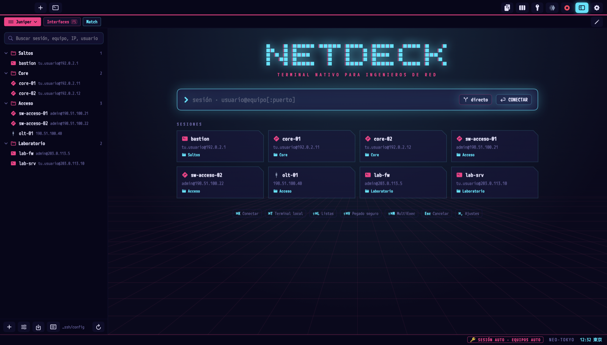

<div align="center">

# Terminal NetDeck

**El terminal de macOS pensado para quien vive entre routers, switches y bastiones.**

Sesiones con saltos, contraseñas que nunca acaban en el equipo equivocado, MultiExec, explorador SFTP/FTP
y 51 temas. Nativo, rápido y en tu idioma.

[](https://github.com/Iljonis/Terminal-NetDeck/releases/latest)

Versión actual: **[v0.9.9](https://github.com/Iljonis/Terminal-NetDeck/releases/tag/v0.9.9)** · macOS 15 o posterior ·
código abierto (MIT)

[](https://github.com/Iljonis/Terminal-NetDeck/releases/tag/v0.9.9)
[](https://github.com/Iljonis/Terminal-NetDeck/actions/workflows/tests.yml)
[](LICENSE)
[](https://www.swift.org)
[](https://www.apple.com/macos/)

**Español** · [English](README.en.md)



</div>

## Por qué Terminal NetDeck

Si administras una red, tu día es abrir veinte sesiones detrás de un bastión, escribir la misma contraseña una y
otra vez, pegar configuraciones con miedo a un `reload` y mover archivos entre servidores. Terminal NetDeck junta
todo eso en una sola app de macOS, con una idea fija: **que nunca te juegue una mala pasada.**

- Tus sesiones son las de tu `ssh_config`: `ssh core-01` sigue funcionando desde cualquier otra terminal.
- Las contraseñas viven sólo en el Llavero y sólo se escriben para el usuario y el equipo que de verdad las piden.
- Si algo sale mal (una contraseña que falla, un servidor que no contesta, una copia que se corta), la app se para,
  te avisa y conserva las copias que puedan necesitar recuperación.

## Funciones clave

- **Resaltado de la salida** para Cisco, Juniper, Huawei, Nokia SR-OS y Linux: IPs, interfaces, estados, BGP, alarmas.
- **Explorador SFTP/FTP** con copias atómicas, verificación MD5 integrada y envío de servidor a servidor.
- **Multipestaña** con vista dividida, MultiExec y pegado seguro; **51 temas** con contraste WCAG.
- **Sesiones con saltos** sobre tu `ssh_config` y contraseñas sólo en el Llavero de macOS.

### Novedades de 0.9.9

- **Grupos con submenú en «+»:** al pasar el ratón por una carpeta salen sus sesiones (también las de subcarpetas)
  para abrir una de un clic, y **Abrir todas** para abrirlas juntas como antes.
- **Autopass más fiable:** aguanta el historial lleno, `clear`, la pantalla alternativa de tmux, screen, less o vi y
  los cortes de conexión sin perder ni repetir la contraseña; un Esc ya no se come la tecla siguiente.
- **Askpass y Llavero:** Intro guarda, siempre dice si quedó guardada y un error del Llavero ya no se toma por «no
  está». El explorador SFTP avisa en la barra si guardó la contraseña.

### Novedades de 0.9.8

- **Contraseñas como en SecureCRT:** una sola lista de contraseñas con nombre, que eliges por su nombre en sesiones,
  grupos, botones y listas, con **Nueva…** al lado de cada selector. Ajustes → Contraseñas dice dónde se usa cada una.
- **¿La guardo?** Si escribes tú una contraseña y entras, la app te ofrece guardarla en el Llavero y asignarla a esa
  sesión. Si no valía, no pregunta.
- **Botones con la contraseña escrita:** un botón de contraseña puede llevarla dentro, sin Llavero. Sólo se escribe
  cuando piden «Password:», nunca se ve en pantalla ni en los registros y no sale al exportar.
- **Listas de equipos:** los que se quedan en el salto sin llegar a pedir contraseña se reintentan una vez.
- Menos dependencias: la app usa sólo el `ssh` de macOS.

### Novedades de 0.9.7

- **Botones de contraseña siempre:** los botones de contraseña y de login y el menú 🔑 escriben también cuando la
  sesión pide la contraseña al conectar. El login sólo la escribe si la piden para su mismo usuario.
- **Botones de orden con aviso:** ante una petición de contraseña no escriben nada y dicen por qué.
- **Vista dividida:** el teclado se queda en el panel donde haces clic, así que el autopass y los botones (también
  F5…) actúan en ese panel.
- **Bloqueo de 15 min sólo para la contraseña por defecto** escrita sola al hacer ssh/telnet desde una sesión. Las
  sesiones guardadas y lo que escribes tú con botones o con 🔑 ya no bloquean; si la guardada falla, se te pide a ti.

### Novedades de 0.9.6

- **Autopass con historial y Tab:** reconoce la orden SSH/Telnet elegida al pulsar Intro desde el mismo prompt,
  también al volver al equipo o abrir otra pestaña. La salida de un `show run` o un banner no inicia un login.
- **Autopass sin intentos perdidos:** reevalúa la misma petición si llega salida mientras se consulta el Llavero y
  continúa cuando otra pestaña confirma la contraseña; Esc y los bloqueos por rechazo siguen deteniéndolo.
- **Llavero en segundo plano:** las esperas de las operaciones síncronas dejan libres las tareas de Swift.
- **Gestor de credenciales editable:** cambia el nombre, o el usuario y equipo, sin volver a introducir la contraseña.
  Renombrar actualiza las asignaciones y conserva el bloqueo por fallo; si algo falla, mantiene las entradas recuperables.
- **Asignaciones más claras:** elige una credencial con nombre, hereda la del grupo o usa la propia del equipo. Puedes
  crear una credencial desde el editor de sesiones. La predeterminada muestra su usuario exacto y las entradas ausentes.
- **Catálogo del Llavero con búsqueda y recarga**, sin consultas en el hilo de la interfaz ni sobrescrituras silenciosas al añadir.

- **Varias ventanas:** ⌘N abre otra; las pestañas pasan de una ventana a otra arrastrándolas o con clic derecho, sin
  cortar la conexión. Cada ventana vuelve al reabrir con sus pestañas y su sitio.
- **Renombrar la pestaña** (clic derecho): el nombre se mantiene mientras sigas en ese equipo, también al reconectar.
- **Exportar e importar botones** en Ajustes → Botones, para compartirlos; las contraseñas no viajan.
- **Contraseñas más precisas:** las sesiones guardadas usan su contraseña y la de cada salto sin esperar a otras
  pestañas; en equipos abiertos desde una sesión la ayuda sólo se activa al enviar una orden SSH/Telnet, nunca por
  un `show run`, un banner o un registro.
- **Túneles y listas de equipos** más robustos ante procesos que terminan y credenciales de cada salto.
- **Pantalla completa:** corregido el hueco superior y la barra de pestañas que tapaba el buscador y la primera
  línea del terminal.

### Novedades de 0.9.3

- **Barra de pestañas completa:** el ancho se calcula desde la ventana para evitar que se reduzca a una sola pestaña. Los controles permanecen fijos arriba a la derecha.
- **Ratón corregido en las pestañas:** selección y cierre por el recorrido normal de AppKit, con gestos que permiten
  arrastrar desde todo el cuerpo de la pestaña y mantener la ventana quieta. La X conserva su área de 24 × 24.
- **Contraseñas complejas del Llavero:** las que llevan ñ, €, º, acentos o «\\» se escribían mal (macOS las
  devolvía en hexadecimal) y una cuenta AD quedaba bloqueada 15 min; ahora se escriben tal cual.
- **Validación del paquete publicado:** la comprobación funcional usa la `.app` producida para distribuir, exige
  cambios de selección, cierres y arrastres efectivos y falla si se omiten casos o falta el informe.
- **Automatización y archivos:** MultiExec respeta las reservas de macros en cada destino; edición remota con
  publicación de copias sin reemplazar otra y recuperación de guardados pendientes al reconectar.

- **SFTP junto al terminal SSH:** mismo equipo, configuración `-F` y saltos; ancho recordado por sesión.
  Se conecta al llegar el terminal a su prompt. Una ruta con salto escrito a mano no ofrece este panel.
- **Edición remota:** abre archivos de texto de hasta 5 MB en tu editor. Al guardar comprueba la versión remota
  y avisa de conflictos; puedes conservar la edición como copia. Al cerrar la pestaña las copias locales abiertas
  se conservan en `~/Library/Application Support/Terminal NetDeck/edicion/` para que puedas recuperarlas.
  En SFTP la subida sólo sustituye el archivo si sigue como se bajó. En FTP el servidor no garantiza no pisar un
  archivo que aparezca a la vez: se conserva la copia local y sólo se sube si confirmas «Sobrescribir».
  «Guardar como copia» requiere un servidor con publicación exclusiva (SFTP).
- **Espacios de trabajo:** Herramientas → Espacios de trabajo guarda orden, selección, panel SFTP y distribución
  de las pestañas, incluidos los tamaños relativos de los paneles. Puedes añadirlas a la ventana o sustituir las
  actuales con confirmación. Las sesiones se resuelven de nuevo por nombre; las borradas se avisan. No se guardan
  conexiones loopback ni saltos escritos a mano. MultiExec queda apagado y no se ejecutan macros ni túneles.
- **Macros:** grabar, editar y reproducir órdenes, esperar prompt o texto y añadir pausas. La reproducción se para
  ante errores, paginadores o peticiones de secretos. La grabación omite una línea si no puede reconocer con seguridad
  el prompt antes de su primera tecla, también al pegar por fragmentos. No incluyas secretos en órdenes ni macros.
- **Túneles SSH:** locales (`-L`), remotos (`-R`) y SOCKS (`-D`), con estado e inicio/parada explícitos.
  Escucha local por defecto; la exposición a otros equipos requiere marcarla. Si el ssh_config ya define reenvíos,
  el gestor rechaza el inicio para evitar activar escuchas ocultas. El puerto remoto depende además de GatewayPorts
  y de los permisos del servidor. Ningún túnel se inicia al cargar su lista.
- **Perfiles por sesión:** tema, fuente, tamaño, historial, teclado y prompt en anotaciones del propio ssh_config
  (`# @tema`, `# @fuente`, `# @scrollback`, `# @teclado`, `# @prompt`); lo no definido hereda de Ajustes.
  «Conectar» sin guardar aplica el perfil del formulario sólo a esa pestaña. Las expresiones regulares tienen límites
  de coste y no convierten una petición de contraseña/OTP ni un rechazo en un prompt válido.
- **Consola serie nativa:** aplica y comprueba la trama, cancela la salida pendiente al cerrar y permite enviar
  BREAK desde el menú Terminal. La compatibilidad con adaptadores concretos requiere probar el hardware.
- **Pestañas:** arrastre en toda su superficie y cierre con una zona de 24 × 24 puntos que resalta al pasar el ratón.
- **Actualización:** conserva staging y la app anterior incluso si falla la restauración. Las copias previas incluyen
  también macros, túneles, espacios y estado del panel SFTP. Si esa copia no se puede hacer (un archivo ilegible, sin
  carpeta de copias), no se instala ni se actualiza: la app de antes sigue tal cual y se dice por qué.

## Requisitos y compatibilidad

- macOS Sequoia (15.0) o posterior.
- Para compilar desde el código: Swift 6 (Xcode o Command Line Tools).

## Instalación y primer uso en macOS 15 (Sequoia)

1. **Descarga** `Terminal-NetDeck.dmg` de la [última versión](https://github.com/Iljonis/Terminal-NetDeck/releases/latest).
2. **Ábrelo** y arrastra **Terminal NetDeck** a **Aplicaciones**.
3. **Autoriza la app una vez.** La app se distribuye con firma *ad hoc* y sin notarizar. El método recomendado es
   retirar el atributo de cuarentena desde Terminal:

   ```bash
   sudo xattr -cr "/Applications/Terminal NetDeck.app"
   ```

   > **Alternativa gráfica:** abre la app una vez y, tras el aviso de macOS, ve a **Ajustes del Sistema → Privacidad y
   > seguridad → Abrir igualmente**.

4. **Ábrela.** El asistente configura sesiones, tema, fuente, contraseñas y resaltado.

Las actualizaciones desde la propia app y las instalaciones con `./install.sh` no necesitan este paso.

Tus datos se quedan en tu Mac: la configuración en `~/Library/Application Support/Terminal NetDeck/`, las sesiones en
formato `ssh_config` y las contraseñas, sólo en el Llavero de macOS. Actualizar sólo sustituye la app: antes se copian
tus sesiones, `~/.ssh/config`, botones y listas en `~/Library/Application Support/Terminal NetDeck/copias/`, y si al
arrancar faltara el archivo de sesiones o su `Include`, la app los recupera sola.


### Mantenerla al día

- **Desde la propia app.** Una vez al día comprueba en silencio si hay versión nueva. Si la hay, verás un aviso
  discreto en la barra de estado: pulsa **Actualizar ahora** y se descarga, se comprueba (sha256 publicado por GitHub y
  firma) y se vuelve a abrir con tus pestañas. Nunca se instala nada sin ese clic.
- **Desde el código, en un momento:**

  ```bash
  cd Terminal-NetDeck
  git pull
  ./actualizar.sh        # compila, sustituye la app y la reabre con tus pestañas
  ```

<details>
<summary><b>Instalar desde el código</b> (macOS 15+ y Swift 6)</summary>

```bash
xcode-select --install          # si no tienes Xcode ni las Command Line Tools
git clone https://github.com/Iljonis/Terminal-NetDeck.git
cd Terminal-NetDeck
./install.sh                    # compila y la instala en /Applications (o ~/Applications)
```

| Orden | Para qué |
|---|---|
| `./install.sh --usuario` | Instalarla en `~/Applications` |
| `./install.sh --dmg` | Crear `dist/Terminal-NetDeck.dmg` |
| `./install.sh --asistente` | Abrir el asistente sin instalar (para probarlo) |
| `./install.sh --fuente "Kode Mono"` | Instalar una fuente con Homebrew |
| `./desinstalar.sh [--todo]` | Quitar la app (`--todo`: también temas y ajustes; el Llavero no se toca) |

</details>

## Lo que hace por ti

### 🔐 Contraseñas que no se equivocan de sitio

- **Sólo en el Llavero** de macOS: nunca en archivos, argumentos ni registros (salvo la que tú escribas en un botón).
- **Las sesiones guardadas abren directamente:** SSH/SFTP usan su contraseña asignada y la propia de cada salto, sin adivinar ni esperar a otras pestañas. Telnet se inicia a mano.
- **Equipos abiertos desde una sesión:** la ayuda sólo se activa al enviar una orden SSH/Telnet y termina al entrar, cancelar o enviar otra orden. Un `show run`, `show config`, banner o registro no la activa. El modo sugerir ofrece las credenciales compatibles en un selector pequeño ligado a esa pestaña y ese login.
- **Regla de usuario estricta:** una contraseña sólo se escribe sola si es exactamente del usuario que la pide.
- **Y del equipo correcto:** un servidor que escriba en pantalla un `admin@core-01's password:` falso no se lleva la
  contraseña de core-01; sólo cuentan el destino y los saltos de esa pestaña.
- **Si la credencial por defecto, escrita sola, falla, no se vuelve a escribir sola en 15 minutos** en ninguna pestaña,
  para no bloquear tu cuenta de Active Directory. Las de las sesiones no se bloquean (si una no vale, te la pide), y
  lo que eliges tú —menú 🔑 o un botón— se escribe siempre.
- **El Llavero nunca congela la app:** se consulta en segundo plano y con un tope de 10 segundos.
- Menú 🔑 para escribir cualquiera a mano, también en prompts raros que la app no reconoce.

En **Ajustes → Contraseñas** tienes tu lista: cada una con su nombre (por ejemplo, «Red principal»), dónde se usa,
**Cambiar…** (nombre o contraseña; deja los campos vacíos para conservarla) y la papelera. **Nueva…** añade otra; un
nombre existente no se sobrescribe. Las antiguas de usuario y equipo siguen funcionando, plegadas al final.

En **Sesiones → Contraseña**, elige una por su nombre, la del grupo o **Nueva…** para crearla ahí mismo; **Para todo
el grupo** la asigna a todas las del grupo. La indicación **Usa:** muestra la que se usará; pulsa **Guardar** para
conservar la asignación. Cada salto usa la de su propia sesión. Si escribes tú la contraseña y entras, la app te
ofrece guardarla (se puede desactivar en Ajustes → Contraseñas).

La **Credencial predeterminada** se elige en Contraseñas junto con su **Usuario exacto**: actúa como alternativa para
los equipos abiertos desde una sesión. Dejarla en **Ninguna (preguntar)** o vaciar el usuario la desactiva. El login
inicial de una sesión guardada usa su asignación, sin recurrir a la predeterminada.

Al renombrar se actualizan sesiones, grupos, botones, listas y predeterminada. Si una configuración externa aún usa
el nombre anterior, la app conserva esa entrada y lo indica. Los archivos externos no se reescriben; los secretos
siguen únicamente en el Llavero de macOS.

### 🛡️ Saltos y bastiones, sin sorpresas

- Tus sesiones con `ProxyJump`, encadenadas, y telnet a través del salto.
- **Una sola conexión al bastión:** las pestañas que pasan por el mismo salto la comparten (como SecureCRT; abierta
  2 min tras cerrar la última) y no se vuelven a autenticar en él. Se desactiva en Ajustes → General → Conexiones.
- **Salto a mano blindado:** si un bastión no deja reenviar (`-J`), la app te pregunta antes de entrar en él, y la
  contraseña del destino sólo se sugiere, nunca se escribe sola por la shell del salto.
- **Nada de inyecciones:** un equipo o usuario que empiece por `-` no llega a ssh como opción, todas las órdenes
  llevan `--` antes del destino y al importar sesiones sólo pasan las opciones de ssh seguras (fuera `ProxyCommand`,
  bloques `Host *`, reenvíos de puertos…).

### 📂 Explorador SFTP/FTP con protección de archivos

- Árbol y lista con tamaños, permisos, dueño y fecha; subir arrastrando desde el Finder, bajar, renombrar, borrar.
- **Copias atómicas:** se escribe primero en un temporal y sólo al acabar se sustituye el archivo. Una copia que falla
  o cancelas conserva los archivos recuperables y sus permisos; si el servidor no confirma el reemplazo, se indican
  las rutas que debes revisar.
- **Integridad MD5:** cada archivo se vuelve a leer del destino y su MD5 tiene que coincidir con el del origen.
- **De servidor a servidor** («Enviar a…»), SFTP ↔ SFTP o SFTP ↔ FTP, en memoria y sin tocar el disco del Mac.
- **Cancelación con esperas acotadas:** un reemplazo incierto conserva sus temporales y la copia anterior para
  recuperarlos.


### ⚡ Trabajar en muchos equipos a la vez

- **MultiExec** y **vista dividida:** lo que escribes va a la vez a varios paneles (excluye los que quieras).
- **Pegado seguro:** línea a línea esperando al prompt; se para ante errores de la CLI, paginadores, órdenes
  peligrosas sin confirmar (`reload`, `delete`…) o una petición de contraseña.
- **Listas de equipos:** la misma orden en muchos equipos detrás de un salto, probando la contraseña de uno en uno.
- **Barra de botones** con categorías, teclas F1–F12 y huecos como `{{vlan=100}}`. En Ajustes → Botones se
  **exportan** a un `.txt` para pasárselos a un compañero y se **importan** los suyos (añadiéndolos a los tuyos sin
  repetir, o sustituyéndolos). Las contraseñas no viajan: sólo el nombre con el que están en el Llavero.

### 🗂️ Pestañas que se adaptan

- Se reparten el ancho de la ventana y, si no caben, se desplazan sin perder de vista la activa.
- El título es sólo el **equipo de destino** (`core-02`, no `core-02 ⟵ bastion`); el camino entero sale al pasar el
  ratón. Si desde una sesión saltas a otro equipo, la pestaña lo refleja.
- Los botones de la barra nunca se salen de la ventana, tengas las pestañas que tengas.
- Arrastrar una pestaña nunca mueve la ventana, tampoco con la ventana en «Rellenar».
- **Renombrar la pestaña** (clic derecho): el nombre que pones se queda mientras sigas en ese equipo (también al
  reconectar) y vuelve el del equipo cuando sale el prompt de otro.
- **Varias ventanas:** ⌘N abre otra. Arrastra una pestaña fuera de su ventana para llevarla a otra pantalla (se abre
  ahí una ventana con ella) o a la barra de otra ventana; o clic derecho → «Mover a una ventana nueva» / «Mover a la
  ventana». La conexión sigue tal cual, sin reconectar. Al salir se guarda cada ventana con sus pestañas y su sitio,
  y al reabrir vuelven así. Cerrar una ventana con conexiones abiertas pregunta antes; la última cierra la app como
  siempre.


### 🧰 Y además

- **Tipos de sesión:** SSH, Telnet, SFTP, FTP, terminal local y consola serie (velocidad, bits, paridad y parada aplicados y comprobados).
- **Gestor de sesiones** con carpetas (`Clientes/Madrid/Core`), favoritas, recientes y botón **Conectar** para probar
  sin guardar.
- **Importar** de SecureCRT, MobaXterm, PuTTY, electerm, CSV u otro `ssh_config`; **exportar** a JSON o CSV.
  Nunca contraseñas.
- **Resaltado de la salida** tipo ChromaTerm (IPs, MAC, interfaces, estados, BGP, dBm, errores…) para Cisco, Juniper,
  Huawei, Nokia SR-OS (prompts clásico y MD-CLI, puertos `1/1/c1/1`, alarmas) y Linux, con los colores del tema,
  editable con vista previa. Puedes elegir qué tono es cada color del resaltado, por tema, sin tocar la interfaz; si
  tienes reglas tuyas, las nuevas de cada versión se añaden con un clic.
- **Selección rectangular:** mantén ⌥ y arrastra para copiar sólo unas columnas (las IP de un `show ip interface
  brief`, sin el resto de la línea).
- **Historial configurable:** 2.500 líneas por pestaña de serie; 1.000, 5.000 o 10.000 en Ajustes → Terminal.
- **Registro** de las sesiones en texto limpio y **búsqueda** en todos ellos (IP, MAC en cualquier formato…).
- **Sin avisos de locale** en servidores Linux: ssh no manda el idioma del Mac salvo que lo actives.
- **Español de España e inglés**, se cambia al momento en Ajustes → General → Idioma.


## 🎨 51 temas para cada turno

Desde un NOC de guardia a las tres de la mañana hasta una presentación con proyector. Todos tienen su paleta ANSI y su
fuente, pueden **seguir al modo claro u oscuro del Mac**, y **todos pasan una prueba de contraste WCAG** (texto
≥ 4,5:1). ¿Quieres el tuyo? Copia un archivo `.tema` de `Temas/`, cambia los colores e impórtalo. Además está el de
serie, **NetDeck Cyberpunk**.


<details>
<summary><b>Ver el catálogo completo</b></summary>

| Grupo | Tema | Cómo es |
|---|---|---|
| **Cyberpunk** | **Cyber Neón** | Amarillo eléctrico, cian y rojo neón sobre negro. |
|  | **Corpo rojo** | Negro, rojo corporativo y blanco. Sobrio, con rótulos en kanji. |
|  | **Neo-Tokyo** | Cyberpunk japonés: índigo profundo, magenta y cian. |
|  | **Synthwave** | Atardecer retrowave: rosa, violeta y naranja. |
|  | **Grid** | Negro absoluto con cian eléctrico y naranja (estilo Tron). |
|  | **Vaporwave** | Turquesa y rosa pastel sobre violeta, estética noventera. |
| **Sistemas** | **Liquid Glass** | Como macOS 27: cristal transparente y desenfocado, con los colores del sistema. |
|  | **Liquid Glass Claro** | macOS 27 de día: vidrio claro y desenfocado, texto oscuro bien legible. |
|  | **Windows 11** | Fluent y Mica: gris oscuro translúcido, acento azul, Cascadia Mono y la paleta Campbell. |
|  | **Windows 11 Claro** | Fluent de día: Mica clara, acento azul y la paleta «One Half Light». |
| **Anime y cine** | **Unidad-01** | Morado y verde neón, avisos en naranja (estilo EVA-01). |
|  | **Unidad-02** | Rojo y naranja intensos con verde lima (estilo EVA-02). |
|  | **Neo-Tokio rojo** | Rojo moto, negro y blanco con kanji (estilo Akira). |
|  | **Fantasma rojo** | Rojo, negro y blanco con contraste brutal (estilo Persona 5). |
|  | **Replicante** | Neblina naranja y azul petróleo (estilo Blade Runner). |
|  | **Sección 9** | Verde agua y blanco sobre pizarra (estilo Ghost in the Shell). |
|  | **Bosque** | Verdes musgo, cielo y tonos cálidos (estilo Ghibli). |
|  | **Andén** | Panel LED naranja de estación japonesa. |
| **Kawaii** | **Kawaii futurista** | Lavanda oscuro, rosa, menta y lila. Detalles ♡ ✧. |
|  | **Sakura** | Clara y suave, para fondo blanco. |
|  | **Alba rosa** | Clara de amanecer: crema, rosa viejo, lirio y pino (inspirada en Rosé Pine Dawn). |
| **Retro** | **Fósforo** | Monitor clásico de fósforo verde. |
|  | **Ámbar** | Terminal ámbar de los 80, cálida para muchas horas. |
|  | **Otoño retro** | Cálida y con poco azul, inspirada en Gruvbox: buena para la noche. |
|  | **Monokai** | La de los editores de siempre: verde, amarillo y rosa intensos sobre gris oliva. |
|  | **Trigo** | Papel crema con tinta tostada (inspirada en Gruvbox claro): pareja diurna de Otoño retro. |
| **Sobrias** | **Ártico** | Sobria con contraste: hielo, aurora y ámbar. |
|  | **Medianoche** | Azules y violetas suaves (estilo Tokyo Night). |
|  | **Vampiro** | Morado, rosa y verde sobre gris (estilo Dracula). |
|  | **Océano profundo** | Azul abisal con brillos aguamarina y coral. |
|  | **Grafito** | Gris carbón en vez de negro: no deslumbra al pasar de una ventana clara a la terminal. |
|  | **Solar oscuro** | La paleta clásica Solarized en oscuro: descansa la vista en turnos largos. |
|  | **Solar claro** | Solarized en claro: pareja de Solar oscuro (ideal en modo Auto). |
|  | **Moca** | Pasteles suaves sobre fondo oscuro, inspirada en Catppuccin Mocha. |
|  | **Fiordo** | Gris pizarra ártico con azules escarcha (inspirada en Nord): calma para turnos largos. |
|  | **Café con leche** | Clara y cremosa (inspirada en Catppuccin Latte): pareja diurna de Moca. |
|  | **Gran ola** | Tinta índigo, papel envejecido y azules de grabado japonés (inspirada en Kanagawa). |
|  | **Taiga** | Verde bosque apagado con salvia, arena y musgo (inspirada en Everforest). |
| **Prácticas** | **Accesible** | Para daltonismo: bien en azul, mal en naranja. |
|  | **Alto contraste** | Blanco puro sobre negro y colores al máximo. |
|  | **Pro** | El perfil «Pro» de Terminal de macOS. |
|  | **Papel** | Clara y muy legible: oficinas con mucha luz, proyector o compartir pantalla. |
|  | **NOC** | Para pantallas de guardia: lo normal apagado y las alarmas saltando a la vista. |
|  | **Guardia ámbar** | Consola de NOC: ámbar sobre negro cálido, letra grande y estados inconfundibles. |
|  | **Guardia verde** | Consola de NOC: verde suave sobre negro, alarmas en rojo y avisos en ámbar. |
| **Corporativas** | **DIGI** | Azul DIGI Mobil (#1275B7) y el punto rojo del logo, sobre azul marino. |
|  | **Oracle** | Rojo Oracle (#C74634) sobre el gris cálido de Redwood (#312D2A). |
|  | **Cisco** | Azul Cisco (#049FD9) sobre azul noche, con los colores de estado de Cisco. |
|  | **Juniper** | Verde Juniper (#84B135) y lima (#CCDB2A) sobre gris pizarra. |
|  | **Huawei** | Rojo Huawei (#CF0A2C) y su negro (#232527). |
|  | **Ubuntu** | Naranja Ubuntu (#E95420) sobre berenjena (#300A24), como su terminal. |

</details>

## Galería

| | |
|---|---|
|  **Inicio:** tus sesiones a un clic y conexión rápida |  **Explorador SFTP** en vista dividida |
|  **Galería de temas** con vista previa |  **Reglas de resaltado** editables |
|  **Ajustes → Terminal:** historial y selección rectangular (aquí, en inglés) |  **Asistente** de la primera vez |


## Atajos

| Atajo | Qué hace |
|---|---|
| ⌘K | Conectar (sesión o `usuario@equipo[:puerto]`, directo o por un salto) |
| ⌘T | Nueva terminal local |
| ⌘N | Nueva ventana |
| ⇧⌘W | Cerrar la ventana (pregunta si tiene conexiones y hay más ventanas) |
| ⌥⌘K | Abrir la sesión de inicio |
| ⇧⌘E | Gestor de sesiones |
| ⇧⌘L | Listas de equipos |
| ⇧⌘V | Pegado seguro |
| ⇧⌘M | MultiExec |
| ⌘F / ⇧⌘F | Buscar en la salida / en todos los registros |
| Esc o ⌘. | Cortar cualquier secuencia automática |
| ⌥ + arrastrar | Selección rectangular (sólo esas columnas); ⌘C la copia |
| ⌘, | Ajustes |

## Seguridad y privacidad

- Contraseñas sólo en el Llavero, con la regla de usuario y de equipo, y 15 minutos sin escribirse sola la credencial
  por defecto tras un fallo.
- MultiExec y el pegado seguro sólo llegan a pestañas SSH/Telnet: nunca a una terminal local, SFTP o consola serie.
  Una línea sólo se reparte si la empiezas en el prompt del equipo, y sólo a las pestañas que están en el suyo: lo que
  escribes en una contraseña, passphrase, OTP o cualquier petición que no sea un prompt se queda en su pestaña. Si un
  equipo tiene un prompt raro, ponlo en el perfil de la sesión (`# @prompt`).
- Tus archivos (`ssh_config`, botones, listas) nunca se sobrescriben si no se pueden leer, con copia `.anterior` en cada
  guardado; carpetas y archivos de la app sólo para ti (0700/0600).
- Antes de cada actualización y de cada guardado de sesiones, copia fuera de `~/.config/netdeck`; un test comprueba en
  cada cambio que actualizar deja tus sesiones idénticas.
- Actualizaciones sólo de github.com, comprobadas con su sha256 y su firma, y nada se instala sin tu clic.
- Firma ad hoc con hardened runtime.
- Cada cambio pasa una comprobación de privacidad (nada personal en el código, la app ni el `.dmg`) y, cada semana,
  una auditoría de dependencias contra la base de vulnerabilidades OSV.dev.
- Los errores van a `~/Library/Application Support/Terminal NetDeck/logs/error.log` (Ayuda → Abrir el registro de
  errores), nunca con contraseñas.

## Para desarrolladores

```bash
swift build
swift run TerminalNetDeck              # -idioma en: en inglés
./test.sh                              # privacidad + actualizar sin tocar tus datos + tests del núcleo
tools/capturas.sh                      # regenera docs/capturas con datos de ejemplo
tools/verificar_demo.sh                # pasada funcional en la demo antes de un commit o tag
```

| Módulo | Contenido |
|---|---|
| `NetDeckCore/Sessions` | `ssh_config`, saltos, `ssh -J`, telnet por el salto, importadores |
| `NetDeckCore/Security` | Llavero, askpass, regla de usuario, bloqueo compartido tras un fallo |
| `NetDeckCore/Remote` | SFTP y FTP, copias atómicas con MD5, servidor a servidor |
| `NetDeckCore/Productivity` | Pegado seguro, MultiExec, listas por salto, barra de botones |
| `NetDeckCore/Highlight` · `Themes` | Resaltado tipo ChromaTerm · formato `.tema` y catálogo |
| `NetDeckCore/Support` | Rutas, registros, actualizaciones, idiomas (`L("…")` + `Ingles.swift`) |
| `TerminalNetDeck` | La app (SwiftUI) |
| `Temas/` · `Resaltado/` | Catálogo de temas y reglas de resaltado |

Las convenciones del proyecto (textos traducibles, datos de ejemplo, contraseñas, seguridad) y cómo se trabaja con
agentes de revisión están en [CLAUDE.md](CLAUDE.md). Los tests se ejecutan en GitHub Actions en cada push. Para
proponer cambios o avisar de un error, mira [CONTRIBUTING.md](CONTRIBUTING.md).

## Soporte y contribución

- **Errores y peticiones:** [GitHub Issues](https://github.com/Iljonis/Terminal-NetDeck/issues).
- **Contribuir:** consulta [CONTRIBUTING.md](CONTRIBUTING.md).

## Licencia

[MIT](LICENSE) © 2026 Jonay / Iljonis. Hecho con Swift 6, SwiftUI y [SwiftTerm](https://github.com/migueldeicaza/SwiftTerm).
Las licencias de las dependencias y la atribución de las paletas de color están en
[THIRD_PARTY_NOTICES.md](THIRD_PARTY_NOTICES.md), que también va dentro de la app.

## Marcas

Cisco, Oracle, Juniper, Huawei, DIGI, Ubuntu, Apple, macOS, Liquid Glass, Microsoft, Windows y el resto de nombres de
empresas, productos, obras o paletas que aparecen en este proyecto son marcas de sus respectivos propietarios. Se citan
sólo para describir combinaciones de colores o la compatibilidad (por ejemplo, «inspirada en» o «estilo»). Terminal
NetDeck es un proyecto independiente: no está afiliado, patrocinado ni respaldado por ninguno de ellos, y no incluye
logotipos ni recursos oficiales suyos.
