<div align="center">

# Terminal NetDeck

**Cliente SSH para macOS hecho para ingenieros de red: SSH, Telnet, SFTP/FTP y consola serie en una app nativa.**

Una alternativa gratuita y de código abierto a SecureCRT y a MobaXterm en el Mac. Sesiones con saltos sobre tu propio
`ssh_config`, contraseñas sólo en el Llavero, MultiExec con pegado seguro, explorador SFTP con copias comprobadas y
resaltado de la salida de Cisco, Juniper, Huawei y Nokia. En castellano o en inglés.

[](https://github.com/Iljonis/Terminal-NetDeck/releases/latest)

Versión actual: **[v1.0.0](https://github.com/Iljonis/Terminal-NetDeck/releases/tag/v1.0.0)** · macOS 15 o posterior ·
Apple Silicon · código abierto (MIT)

[](https://github.com/Iljonis/Terminal-NetDeck/releases/latest)
[](https://github.com/Iljonis/Terminal-NetDeck/releases)
[](https://github.com/Iljonis/Terminal-NetDeck/actions/workflows/tests.yml)
[](LICENSE)
[](https://www.swift.org)
[](https://www.apple.com/macos/)

**Español** · [English](README.en.md)

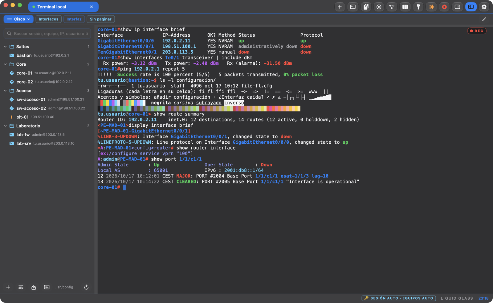

[Novedades](#novedades-de-100) · [Funciones](#funciones-para-ingenieros-de-red) ·
[Temas](#-85-temas-filtros-de-pantalla-y-colores-a-tu-gusto) ·
[Comparación](#comparación-con-securecrt-mobaxterm-iterm2-y-royal-tsx) ·
[Instalación](#instalación-y-primer-uso-en-macos-15-sequoia) · [Primeros pasos](#primeros-pasos) ·
[Preguntas](#preguntas-frecuentes) · [Hoja de ruta](#hoja-de-ruta) · [Contribuir](#contribuir)

</div>

## Por qué Terminal NetDeck

Si administras una red, tu día es abrir veinte sesiones detrás de un bastión, escribir la misma contraseña una y
otra vez, pegar configuraciones con miedo a un `reload` y mover archivos entre servidores. Terminal NetDeck junta
todo eso en una sola app de macOS, con una idea fija: **que nunca te juegue una mala pasada.**

- Tus sesiones son las de tu `ssh_config`: `ssh core-01` sigue funcionando desde cualquier otra terminal.
- Las contraseñas viven sólo en el Llavero y sólo se escriben para el usuario y el equipo que de verdad las piden.
- Antes de pegar una configuración o de mandar un `reload` a diez equipos con MultiExec, te lo enseña y pregunta.
- Si algo sale mal (una contraseña que falla, un servidor que no contesta, una copia que se corta), la app se para,
  te avisa y conserva las copias que puedan necesitar recuperación.

**Para quién es:** ingenieros de red, de sistemas y de NOC que trabajan desde un Mac con routers, switches,
cortafuegos y servidores Linux por SSH, Telnet o el puerto de consola.

**Qué no es:** no hace escritorio remoto (RDP, VNC), no tiene versión para Windows ni Linux y no trae un lenguaje de
scripting completo: para eso están las macros, los botones y las listas de equipos.

### Instalar en un minuto

1. Descarga [`Terminal-NetDeck.dmg`](https://github.com/Iljonis/Terminal-NetDeck/releases/latest) y arrastra la app a
   **Aplicaciones**.
2. Autorízala una vez (no está notarizada): `sudo xattr -cr "/Applications/Terminal NetDeck.app"`.
3. Ábrela: el asistente configura sesiones, tema, fuente, contraseñas y resaltado.

¿Prefieres compilarla? `git clone https://github.com/Iljonis/Terminal-NetDeck.git && cd Terminal-NetDeck && ./install.sh`
(macOS 15.6+ y Swift 6.2). Todos los detalles, en [Instalación](#instalación-y-primer-uso-en-macos-15-sequoia).

## Novedades de 1.0.0

- **Liquid Glass de serie:** quien empieza ve el tema Liquid Glass (y Liquid Glass Claro en el modo automático), con
  el cristal de macOS 26 en los botones de la barra, las pestañas y el menú «+»; nunca sobre el texto del terminal.
  Los temas de neón de siempre se sugieren aparte en el asistente, y a quien ya usaba la app no se le cambia el tema,
  aunque nunca lo eligiera.
- **33 temas nuevos, 85 en total:** diez «Neon Glass», que unen el cristal de macOS 26 con el neón, con brillo
  y cristal teñido del color del tema, y cinco familias nuevas: Ordenadores clásicos, Ciencia ficción, Centro de
  datos, Naturaleza (cada uno en claro y en oscuro) y Videojuegos retro. [Ver cuáles](#temas-nuevos-en-100).
- **Filtros de pantalla sobre el terminal:** CRT, LCD, fósforo y holograma, con su intensidad. Se cambian o se apagan
  desde Ajustes y desde el menú, cada tema puede traer el suyo y se apagan con las opciones de accesibilidad del Mac.
- **Colores a tu gusto en cualquier tema:** una capa de cambios encima del tema, con vista previa, aviso de contraste
  y restablecer; guárdala como tema nuevo y expórtala a un `.tema`.
- **Fuentes:** tamaño de 8 a 36 viendo el tamaño real, ⌘+ / ⌘- / ⌘0, interlineado, suavizado y un aviso si falta la
  fuente del tema.
- **Mucho más rápido con historiales largos:** cada Intro o cada salida ya sólo lee la pantalla y lo nuevo. Con
  100.000 líneas de historial, un Intro pasa de ~250 ms a menos de 1 ms (Ajustes ofrece hasta 10.000; las 100.000 se
  piden por sesión con `# @scrollback 100000`).
- **Accesibilidad:** con «Reducir transparencia» o «Aumentar contraste» la app se pinta opaca; VoiceOver lee los
  botones, las pestañas y las sesiones; los menús se recorren con ↑ ↓ e Intro; «Distinguir sin color» cambia la forma
  del punto de estado; el naranja de los temas es naranja de verdad.
- **Atajos y detalles:** ⌘1…⌘9 para ir a cada pestaña, ⌘Q pregunta si hay Ajustes sin guardar, favoritas con copia
  de seguridad y un tope para las recientes.
- **Por dentro:** Swift 6.2 (copias SFTP y MD5 siempre fuera del hilo principal) y SwiftTerm 1.99.3.

Todos los cambios, versión a versión, en el [CHANGELOG](CHANGELOG.md).

## Funciones para ingenieros de red

### 🔐 Contraseñas en el Llavero de macOS, sin equivocarse de equipo

- **Sólo en el Llavero** de macOS: nunca en archivos, argumentos ni registros (salvo la que tú escribas en un botón).
- **Una lista de contraseñas con nombre**, como en SecureCRT: eliges «Red principal» en una sesión, un grupo, un
  botón o una lista de equipos, con **Nueva…** al lado de cada selector.
- **Las sesiones guardadas abren directamente:** SSH/SFTP usan su contraseña asignada y la propia de cada salto, sin
  adivinar ni esperar a otras pestañas. Telnet se inicia a mano.
- **Regla de usuario estricta:** una contraseña sólo se escribe sola si es exactamente del usuario que la pide.
- **Y del equipo correcto:** un servidor que escriba en pantalla un `admin@core-01's password:` falso no se lleva la
  contraseña de core-01; sólo cuentan el destino y los saltos de esa pestaña.
- **Tu cuenta de Active Directory, a salvo:** si la credencial por defecto, escrita sola, falla, no se vuelve a
  escribir sola en 15 minutos en ninguna pestaña (salvo si ha entrado hace menos de 5 minutos: entonces el rechazo es
  de ese equipo, y la escribes tú sólo esa vez). Se desbloquea con un clic en la barra de abajo. Las de las sesiones
  no se bloquean (si una no vale, te la pide), y lo que eliges tú —menú 🔑 o un botón— se escribe siempre.
- **El Llavero nunca congela la app:** se consulta en segundo plano y con un tope de 10 segundos.

<details>
<summary><b>Cómo se eligen y se asignan las contraseñas</b></summary>

- **Equipos abiertos desde una sesión:** la ayuda sólo se activa al enviar una orden SSH/Telnet y termina al entrar,
  cancelar o enviar otra orden. Un `show run`, `show config`, banner o registro no la activa. El modo sugerir ofrece
  las credenciales compatibles en un selector pequeño ligado a esa pestaña y ese login.
- Menú 🔑 para escribir cualquiera a mano, también en prompts raros que la app no reconoce.

En **Ajustes → Contraseñas** tienes tu lista: cada una con su nombre (por ejemplo, «Red principal»), dónde se usa,
**Cambiar…** (nombre o contraseña; deja los campos vacíos para conservarla) y la papelera. **Nueva…** añade otra; un
nombre existente no se sobrescribe. Las antiguas de usuario y equipo siguen funcionando, plegadas al final.

En **Sesiones → Contraseña**, elige una por su nombre, la del grupo o **Nueva…** para crearla ahí mismo; **Para todo
el grupo** la asigna a todas las del grupo. La indicación **Usa:** muestra la que se usará; pulsa **Guardar** para
conservar la asignación. Cada salto usa la de su propia sesión. Si escribes tú la contraseña de la sesión y entras,
la app te ofrece guardarla (se puede desactivar en Ajustes → Contraseñas).

La **Credencial predeterminada** se elige en Contraseñas junto con su **Usuario exacto**: actúa como alternativa para
los equipos abiertos desde una sesión. Dejarla en **Ninguna (preguntar)** o vaciar el usuario la desactiva. El login
inicial de una sesión guardada usa su asignación, sin recurrir a la predeterminada.

Al renombrar se actualizan sesiones, grupos, botones, listas y predeterminada. Si una configuración externa aún usa
el nombre anterior, la app conserva esa entrada y lo indica. Los archivos externos no se reescriben; los secretos
siguen únicamente en el Llavero de macOS.

</details>

### 🛡️ Saltos SSH (jump host) y bastiones, sin sorpresas

- Tus sesiones con `ProxyJump`, encadenadas, y telnet a través del salto.
- **Una sola conexión al bastión:** las pestañas que pasan por el mismo salto la comparten (como SecureCRT; abierta
  2 min tras cerrar la última) y no se vuelven a autenticar en él. Se desactiva en Ajustes → General → Conexiones.
- **Salto a mano blindado:** si un bastión no deja reenviar (`-J`), la app te pregunta antes de entrar en él, y la
  contraseña del destino sólo se sugiere, nunca se escribe sola por la shell del salto.
- **Túneles SSH** locales (`-L`), remotos (`-R`) y SOCKS (`-D`), con estado e inicio y parada a mano.
- **Nada de inyecciones:** un equipo o usuario que empiece por `-` no llega a ssh como opción, todas las órdenes
  llevan `--` antes del destino y al importar sesiones sólo pasan las opciones de ssh seguras (fuera `ProxyCommand`,
  bloques `Host *`, reenvíos de puertos…).

### ⚡ MultiExec, pegado seguro y listas de equipos

- **MultiExec** y **vista dividida:** lo que escribes va a la vez a varios paneles (excluye los que quieras). Un
  `reload`, `clear ip bgp *` o `write erase` pregunta antes de salir hacia varias pestañas.
- **Revisar antes de pegar:** más de 3 líneas, o algo peligroso, se enseña antes de enviarse.
- **Pegado seguro:** línea a línea esperando al prompt; se para ante errores de la CLI, paginadores, órdenes
  peligrosas sin confirmar (`reload`, `delete`…) o una petición de contraseña.
- **Listas de equipos:** la misma orden en muchos equipos detrás de un salto, probando la contraseña de uno en uno.
- **Macros:** grabar, editar y reproducir órdenes, esperar al prompt o a un texto y añadir pausas.
- **Barra de botones** con categorías, teclas F1–F12 y huecos como `{{vlan=100}}`. En Ajustes → Botones se
  **exportan** a un `.txt` para pasárselos a un compañero y se **importan** los suyos (añadiéndolos a los tuyos sin
  repetir, o sustituyéndolos). Las contraseñas no viajan: sólo el nombre con el que están en el Llavero.

<p align="center">
  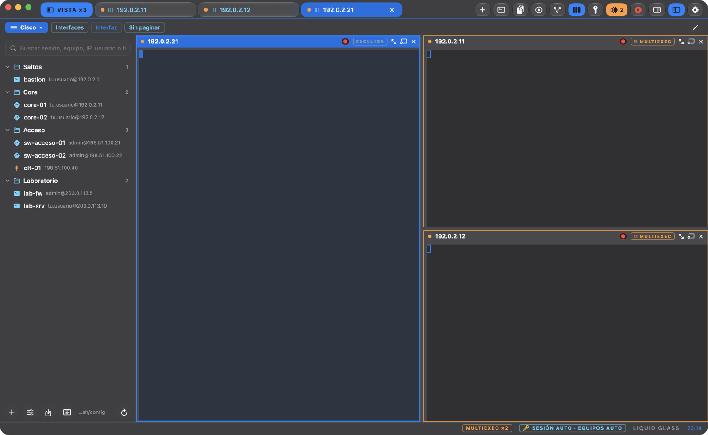
  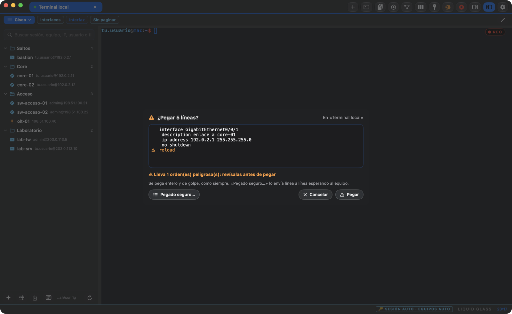
</p>

### 📂 Cliente SFTP y FTP integrado, con copias atómicas

- **Junto al terminal SSH:** el explorador SFTP se abre al lado, con el mismo equipo, usuario y saltos (⇧⌘B).
- Árbol y lista con tamaños, permisos, dueño y fecha; subir arrastrando desde el Finder, bajar, renombrar, borrar.
- **Copias atómicas:** se escribe primero en un temporal y sólo al acabar se sustituye el archivo. Una copia que falla
  o cancelas conserva los archivos recuperables y sus permisos; si el servidor no confirma el reemplazo, se indican
  las rutas que debes revisar.
- **Integridad MD5:** cada archivo se vuelve a leer del destino y su MD5 tiene que coincidir con el del origen.
- **De servidor a servidor** («Enviar a…»), SFTP ↔ SFTP o SFTP ↔ FTP, en memoria y sin tocar el disco del Mac.
- **Edición remota:** abre un archivo de texto de hasta 5 MB en tu editor; al guardar comprueba que nadie lo ha
  cambiado en el servidor.

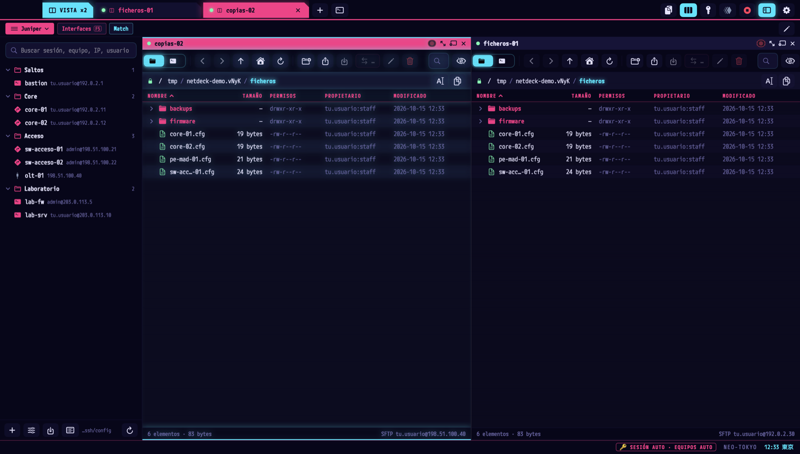

### 🌈 Resaltado de la salida de Cisco, Juniper, Huawei y Nokia

- **Tipo ChromaTerm:** IPs, MAC, interfaces, estados, BGP, dBm, contadores de errores y syslog en color, para Cisco
  IOS, IOS-XE e IOS-XR, Juniper Junos, Huawei VRP, Nokia SR-OS (prompts clásico y MD-CLI, puertos `1/1/c1/1`,
  alarmas) y Linux.
- Con los colores del tema y editable con vista previa. Puedes elegir qué tono es cada color del resaltado, por tema,
  sin tocar la interfaz; si tienes reglas tuyas, las nuevas de cada versión se añaden con un clic.

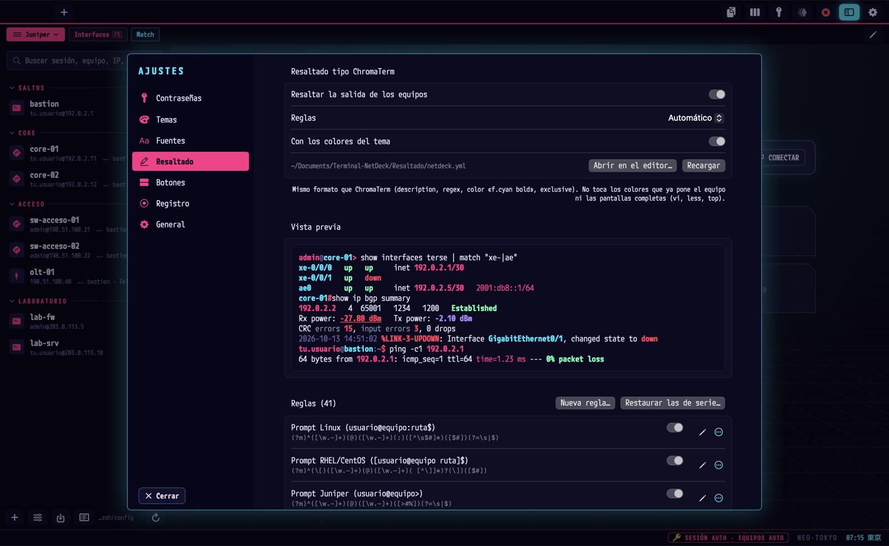

### 🔌 Consola serie, Telnet y terminal local

- **Tipos de sesión:** SSH, Telnet, SFTP, FTP, terminal local y consola serie (velocidad, bits, paridad y parada
  aplicados y comprobados, y BREAK desde el menú Terminal).
- **Sin avisos de locale** en servidores Linux: ssh no manda el idioma del Mac salvo que lo actives.

### 🗂️ Gestor de sesiones, pestañas y varias ventanas

- **Gestor de sesiones** con carpetas (`Clientes/Madrid/Core`), favoritas, recientes y botón **Conectar** para probar
  sin guardar.
- **Importar** de SecureCRT, MobaXterm, PuTTY, electerm, CSV u otro `ssh_config`; **exportar** a JSON o CSV.
  Nunca contraseñas.
- **Perfiles por sesión:** tema, fuente, tamaño, historial, teclado y prompt en anotaciones del propio `ssh_config`
  (`# @tema`, `# @fuente`, `# @prompt`…); lo que no definas hereda de Ajustes.
- Las pestañas se reparten el ancho de la ventana y, si no caben, se desplazan sin perder de vista la activa.
- El título es sólo el **equipo de destino** (`core-02`, no `core-02 ⟵ bastion`); el camino entero sale al pasar el
  ratón. Si desde una sesión saltas a otro equipo, la pestaña lo refleja.
- **Renombrar la pestaña** (clic derecho): el nombre que pones se queda mientras sigas en ese equipo (también al
  reconectar) y vuelve el del equipo cuando sale el prompt de otro.
- **Varias ventanas:** ⌘N abre otra. Arrastra una pestaña fuera de su ventana para llevarla a otra pantalla o a la
  barra de otra ventana, sin reconectar. Al salir se guarda cada ventana con sus pestañas y su sitio.
- **Espacios de trabajo:** guarda el orden, el panel SFTP y la distribución de las pestañas para volver a abrirlas
  juntas.

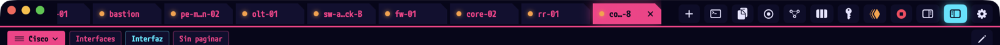

### 🧰 Y además

- **Selección rectangular:** mantén ⌥ y arrastra para copiar sólo unas columnas (las IP de un `show ip interface
  brief`, sin el resto de la línea).
- **Historial configurable:** 2.500 líneas por pestaña de serie; 1.000, 5.000 o 10.000 en Ajustes → Terminal.
- **Registro** de las sesiones en texto limpio y **búsqueda** en todos ellos (IP, MAC en cualquier formato…).
- **Español de España e inglés**, se cambia al momento en Ajustes → General → Idioma.

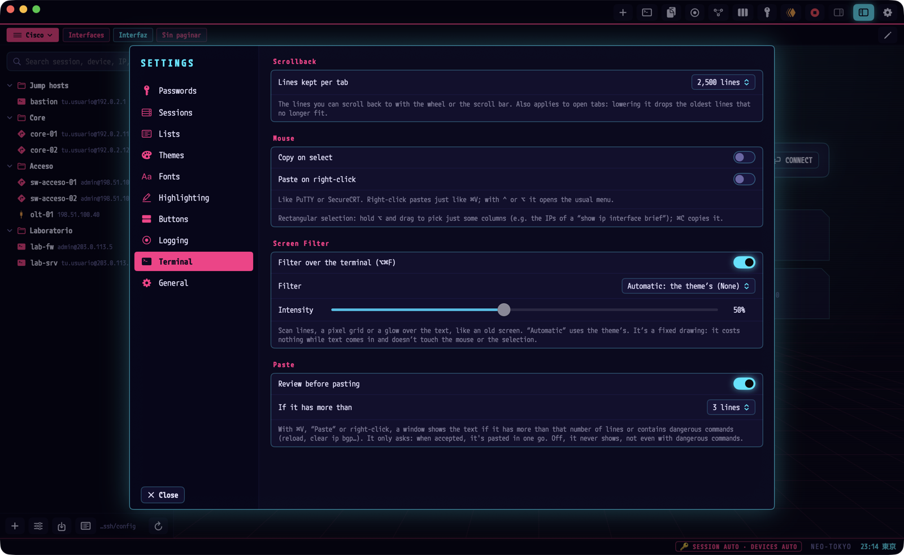

### 🎨 85 temas, filtros de pantalla y colores a tu gusto

Desde un NOC de guardia a las tres de la mañana hasta una presentación con proyector. Todos tienen su paleta ANSI y su
fuente, pueden **seguir al modo claro u oscuro del Mac**, y **todos pasan una prueba de contraste WCAG** (texto
≥ 4,5:1). Además está la original, **NetDeck Cyberpunk**, que siempre queda de reserva.

- **Neon Glass:** el cristal de macOS 26 con neón, con brillo y cristal teñido del color del tema.
- **Filtros de pantalla** sobre el terminal: CRT, LCD, fósforo y holograma, con su intensidad. Se cambian o se apagan
  desde Ajustes y desde el menú, cada tema puede traer el suyo y se apagan con las opciones de accesibilidad del Mac.
- **Colores a tu gusto en cualquier tema:** cambia los que quieras en una capa encima del tema, con vista previa y
  aviso de contraste; restablécelos, guárdalos como tema nuevo o expórtalos a un `.tema` para compartirlo.
- **Fuentes:** tamaño de 8 a 36 viendo el tamaño real, ⌘+ / ⌘- / ⌘0, interlineado, suavizado y un aviso si falta la
  fuente del tema.
- ¿Prefieres partir de cero? Copia un archivo `.tema` de `Temas/`, cambia los colores e impórtalo.

<p align="center">
  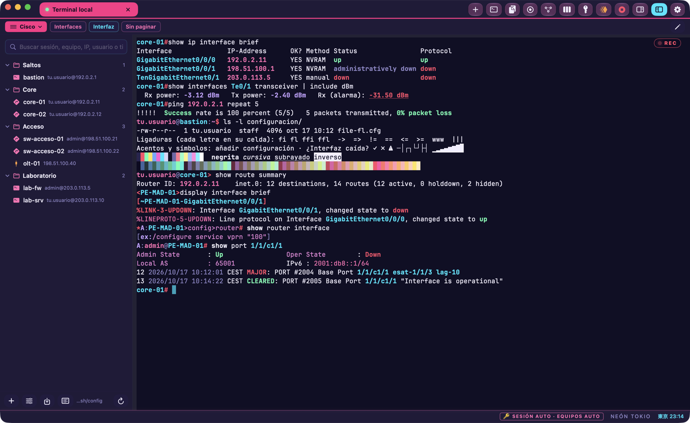
  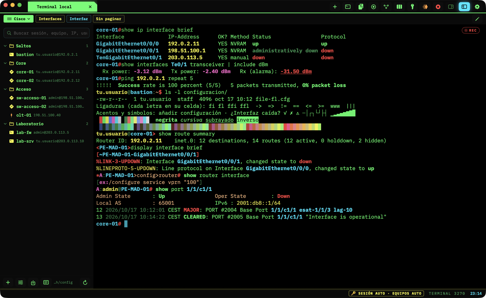
</p>

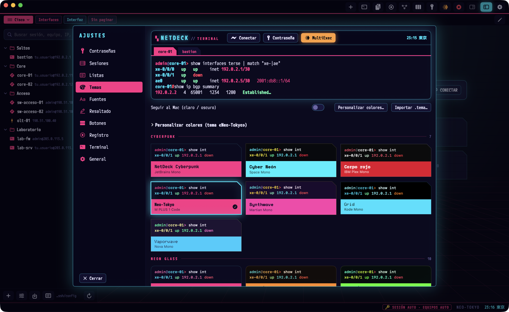

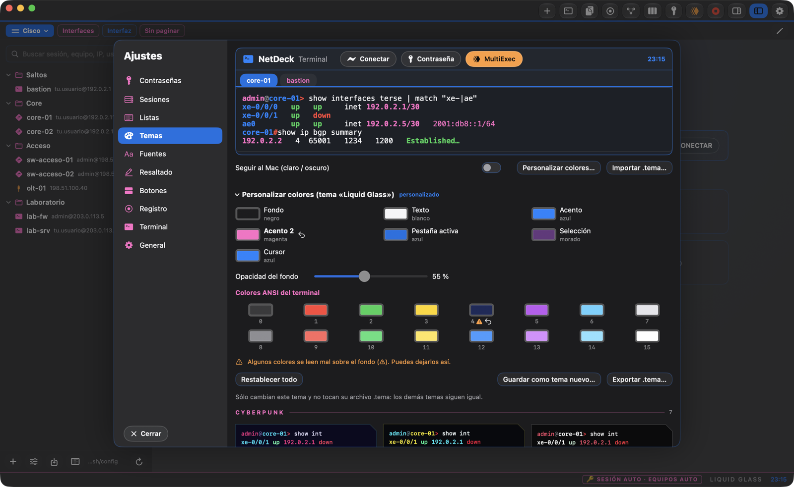

#### Temas nuevos en 1.0.0

| Familia | Temas |
|---|---|
| **Neon Glass** | Neón Tokio, Ámbar, Ácido, Ocaso, Corpo, Hielo, Unidad, Zaibatsu, Nocturna, Sección |
| **Ordenadores clásicos** | Terminal 3270, Comandante, Ocho bits, Banco de trabajo |
| **Ciencia ficción** | Puente de mando, Nostromo, Imperio, HAL |
| **Centro de datos** | Rack, Fibra óptica, NORAD, Consola de rescate |
| **Naturaleza** (8 temas) | Aurora boreal claro y oscuro, Desierto claro y oscuro, Volcán claro y oscuro, Arrecife claro y oscuro |
| **Videojuegos retro** | Portátil verde, Laboratorio, Arcade |

<details>
<summary><b>Ver el catálogo completo: los 52 temas de siempre</b></summary>

| Grupo | Tema | Cómo es |
|---|---|---|
| **Cyberpunk** | **Cyber Neón** | Amarillo eléctrico, cian y rojo neón sobre negro. |
|  | **Corpo rojo** | Negro, rojo corporativo y blanco. Sobrio, con rótulos en kanji. |
|  | **Neo-Tokyo** | Cyberpunk japonés: índigo profundo, magenta y cian. |
|  | **Synthwave** | Atardecer retrowave: rosa, violeta y naranja. |
|  | **Grid** | Negro absoluto con cian eléctrico y naranja (estilo Tron). |
|  | **Vaporwave** | Turquesa y rosa pastel sobre violeta, estética noventera. |
| **Sistemas** | **Liquid Glass** | Como macOS 27: cristal transparente y desenfocado, con los colores del sistema. |
|  | **Liquid Glass Claro** | macOS 27 de día: vidrio claro y desenfocado, texto oscuro bien legible. |
|  | **Windows 11** | Fluent y Mica: gris oscuro translúcido, acento azul, Cascadia Mono y la paleta Campbell. |
|  | **Windows 11 Claro** | Fluent de día: Mica clara, acento azul y la paleta «One Half Light». |
|  | **MobaXterm Net** | Gris carbón y texto blanco, con los colores de un NOC: verde up, rojo down e IPs en azul. |
| **Anime y cine** | **Unidad-01** | Morado y verde neón, avisos en naranja (estilo EVA-01). |
|  | **Unidad-02** | Rojo y naranja intensos con verde lima (estilo EVA-02). |
|  | **Neo-Tokio rojo** | Rojo moto, negro y blanco con kanji (estilo Akira). |
|  | **Fantasma rojo** | Rojo, negro y blanco con contraste brutal (estilo Persona 5). |
|  | **Replicante** | Neblina naranja y azul petróleo (estilo Blade Runner). |
|  | **Sección 9** | Verde agua y blanco sobre pizarra (estilo Ghost in the Shell). |
|  | **Bosque** | Verdes musgo, cielo y tonos cálidos (estilo Ghibli). |
|  | **Andén** | Panel LED naranja de estación japonesa. |
| **Kawaii** | **Kawaii futurista** | Lavanda oscuro, rosa, menta y lila. Detalles ♡ ✧. |
|  | **Sakura** | Clara y suave, para fondo blanco. |
|  | **Alba rosa** | Clara de amanecer: crema, rosa viejo, lirio y pino (inspirada en Rosé Pine Dawn). |
| **Retro** | **Fósforo** | Monitor clásico de fósforo verde. |
|  | **Ámbar** | Terminal ámbar de los 80, cálida para muchas horas. |
|  | **Otoño retro** | Cálida y con poco azul, inspirada en Gruvbox: buena para la noche. |
|  | **Monokai** | La de los editores de siempre: verde, amarillo y rosa intensos sobre gris oliva. |
|  | **Trigo** | Papel crema con tinta tostada (inspirada en Gruvbox claro): pareja diurna de Otoño retro. |
| **Sobrias** | **Ártico** | Sobria con contraste: hielo, aurora y ámbar. |
|  | **Medianoche** | Azules y violetas suaves (estilo Tokyo Night). |
|  | **Vampiro** | Morado, rosa y verde sobre gris (estilo Dracula). |
|  | **Océano profundo** | Azul abisal con brillos aguamarina y coral. |
|  | **Grafito** | Gris carbón en vez de negro: no deslumbra al pasar de una ventana clara a la terminal. |
|  | **Solar oscuro** | La paleta clásica Solarized en oscuro: descansa la vista en turnos largos. |
|  | **Solar claro** | Solarized en claro: pareja de Solar oscuro (ideal en modo Auto). |
|  | **Moca** | Pasteles suaves sobre fondo oscuro, inspirada en Catppuccin Mocha. |
|  | **Fiordo** | Gris pizarra ártico con azules escarcha (inspirada en Nord): calma para turnos largos. |
|  | **Café con leche** | Clara y cremosa (inspirada en Catppuccin Latte): pareja diurna de Moca. |
|  | **Gran ola** | Tinta índigo, papel envejecido y azules de grabado japonés (inspirada en Kanagawa). |
|  | **Taiga** | Verde bosque apagado con salvia, arena y musgo (inspirada en Everforest). |
| **Prácticas** | **Accesible** | Para daltonismo: bien en azul, mal en naranja. |
|  | **Alto contraste** | Blanco puro sobre negro y colores al máximo. |
|  | **Pro** | El perfil «Pro» de Terminal de macOS. |
|  | **Papel** | Clara y muy legible: oficinas con mucha luz, proyector o compartir pantalla. |
|  | **NOC** | Para pantallas de guardia: lo normal apagado y las alarmas saltando a la vista. |
|  | **Guardia ámbar** | Consola de NOC: ámbar sobre negro cálido, letra grande y estados inconfundibles. |
|  | **Guardia verde** | Consola de NOC: verde suave sobre negro, alarmas en rojo y avisos en ámbar. |
| **Corporativas** | **DIGI** | Azul DIGI Mobil (#1275B7) y el punto rojo del logo, sobre azul marino. |
|  | **Oracle** | Rojo Oracle (#C74634) sobre el gris cálido de Redwood (#312D2A). |
|  | **Cisco** | Azul Cisco (#049FD9) sobre azul noche, con los colores de estado de Cisco. |
|  | **Juniper** | Verde Juniper (#84B135) y lima (#CCDB2A) sobre gris pizarra. |
|  | **Huawei** | Rojo Huawei (#CF0A2C) y su negro (#232527). |
|  | **Ubuntu** | Naranja Ubuntu (#E95420) sobre berenjena (#300A24), como su terminal. |

</details>

## Comparación con SecureCRT, MobaXterm, iTerm2 y Royal TSX

Terminal NetDeck no quiere hacerlo todo: es un terminal para trabajar con equipos de red desde un Mac. Si buscas una
alternativa a SecureCRT o a MobaXterm en macOS, esto es lo que hay en cada uno:

| | Terminal NetDeck | SecureCRT | MobaXterm | iTerm2 | Royal TSX |
|---|:-:|:-:|:-:|:-:|:-:|
| Sistemas | macOS | macOS, Windows, Linux | Windows | macOS | macOS (Royal TS en Windows) |
| Precio | Gratis | De pago | Gratis (Home) y de pago (Pro) | Gratis | Gratis con límites y de pago |
| Código abierto | ✅ MIT | ❌ | ❌ | ✅ GPL | ❌ |
| Gestor de sesiones con carpetas | ✅ | ✅ | ✅ | ➖ perfiles | ✅ |
| Sesiones en tu `ssh_config` estándar | ✅ | ❌ formato propio | ❌ formato propio | ➖ no guarda sesiones | ❌ formato propio |
| Saltos y bastiones | ✅ `ProxyJump` | ✅ | ✅ | ➖ con `ssh -J` | ✅ |
| SSH y Telnet | ✅ | ✅ | ✅ | ➖ desde la shell | ✅ |
| Consola serie | ✅ | ✅ | ✅ | ➖ con `screen` o `cu` | ? |
| Explorador SFTP gráfico | ✅ SFTP y FTP | ➖ con SecureFX, aparte | ✅ | ❌ | ✅ |
| Escribir en varias sesiones a la vez | ✅ MultiExec | ✅ | ✅ MultiExec | ✅ | ? |
| Contraseñas en el Llavero de macOS | ✅ | ? | — | ✅ | ? |
| Resaltado de salida de red listo para usar | ✅ | ➖ palabras clave a mano | ? | ➖ triggers con regex | ? |
| Scripting | ➖ macros y botones | ✅ Python, VBScript… | ➖ macros | ✅ API de Python | ➖ tareas |
| Escritorio remoto (RDP, VNC) | ❌ | ❌ | ✅ | ❌ | ✅ |

✅ incluido · ➖ en parte o de otra forma · ❌ no incluido · — no aplica · ? no lo hemos comprobado

Según lo que publica cada producto, a noviembre de 2026 y sin probar todas sus versiones. Si algo está mal o ha
cambiado, [abre un issue](https://github.com/Iljonis/Terminal-NetDeck/issues) y lo corregimos. Cada una tiene
su sitio: SecureCRT va en tres sistemas y tiene scripting de verdad; MobaXterm y Royal TSX hacen además escritorio
remoto; iTerm2 es un gran terminal local. Lo propio de Terminal NetDeck:

- tus sesiones siguen en un `ssh_config` normal, sin formato propio ni exportaciones;
- las contraseñas se escriben sólo para su usuario y su equipo, y la regla de los 15 minutos protege tu cuenta de AD;
- el pegado se revisa y los `reload` o `write erase` se confirman, también con MultiExec;
- las copias SFTP/FTP son atómicas y se comprueban con MD5;
- es nativa (SwiftUI), gratis y de código abierto.

## Requisitos y compatibilidad

- macOS Sequoia (15.0) o posterior.
- Para compilar desde el código: Swift 6.2 o posterior (Xcode 26 o sus Command Line Tools, que piden macOS 15.6 o
  posterior). La app compilada funciona desde macOS 15.0.

## Instalación y primer uso en macOS 15 (Sequoia)

1. **Descarga** `Terminal-NetDeck.dmg` de la [última versión](https://github.com/Iljonis/Terminal-NetDeck/releases/latest).
2. **Ábrelo** y arrastra **Terminal NetDeck** a **Aplicaciones**.
3. **Autoriza la app una vez.** La app se distribuye con firma *ad hoc* y sin notarizar. El método recomendado es
   retirar el atributo de cuarentena desde Terminal:

   ```bash
   sudo xattr -cr "/Applications/Terminal NetDeck.app"
   ```

   > **Alternativa gráfica:** abre la app una vez y, tras el aviso de macOS, ve a **Ajustes del Sistema → Privacidad y
   > seguridad → Abrir igualmente**.

4. **Ábrela.** El asistente configura sesiones, tema, fuente, contraseñas y resaltado.

Las actualizaciones desde la propia app y las instalaciones con `./install.sh` no necesitan este paso.

Tus datos se quedan en tu Mac: la configuración en `~/Library/Application Support/Terminal NetDeck/`, las sesiones en
formato `ssh_config` y las contraseñas, sólo en el Llavero de macOS. Actualizar sólo sustituye la app: antes se copian
tus sesiones, `~/.ssh/config`, botones y listas en `~/Library/Application Support/Terminal NetDeck/copias/`, y si al
arrancar faltara el archivo de sesiones o su `Include`, la app los recupera sola.

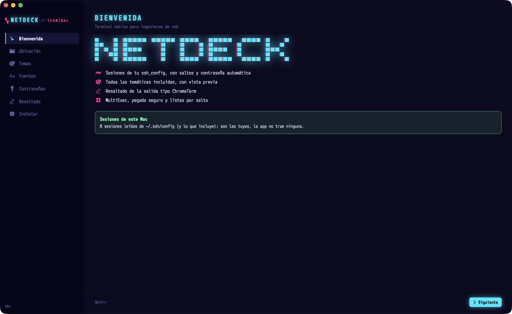

### Mantenerla al día

- **Desde la propia app.** Una vez al día comprueba en silencio si hay versión nueva. Si la hay, verás un aviso
  discreto en la barra de estado: pulsa **Actualizar ahora** y se descarga, se comprueba (sha256 publicado por GitHub y
  firma) y se vuelve a abrir con tus pestañas. Nunca se instala nada sin ese clic.
- **Desde el código, en un momento:**

  ```bash
  cd Terminal-NetDeck
  git pull
  ./actualizar.sh        # compila, sustituye la app y la reabre con tus pestañas
  ```

<details>
<summary><b>Instalar desde el código</b> (macOS 15.6+ y Swift 6.2)</summary>

```bash
xcode-select --install          # si no tienes Xcode ni las Command Line Tools
git clone https://github.com/Iljonis/Terminal-NetDeck.git
cd Terminal-NetDeck
./install.sh                    # compila y la instala en /Applications (o ~/Applications)
```

| Orden | Para qué |
|---|---|
| `./install.sh --usuario` | Instalarla en `~/Applications` |
| `./install.sh --dmg` | Crear `dist/Terminal-NetDeck.dmg` |
| `./install.sh --asistente` | Abrir el asistente sin instalar (para probarlo) |
| `./install.sh --fuente "Kode Mono"` | Instalar una fuente con Homebrew |
| `./desinstalar.sh [--todo]` | Quitar la app (`--todo`: también temas y ajustes; el Llavero no se toca) |

</details>

## Primeros pasos

1. **Abre la app.** El asistente te guía por las sesiones, el tema, la fuente, las contraseñas y el resaltado.
2. **Conéctate al momento** con ⌘K: escribe el nombre de una sesión o `tu.usuario@192.0.2.11`, directo o por un salto.
3. **Guarda tus equipos** en el gestor de sesiones (⇧⌘E), con carpetas y «Saltar por» para el bastión. Se guardan en
   formato `ssh_config`, en el archivo de la app, con un `Include` en tu `~/.ssh/config`:

   ```sshconfig
   # @grupo Core

   Host core-01
       # @clave Red principal
       HostName 192.0.2.11
       User tu.usuario
       ProxyJump bastion
   ```

   Así `ssh core-01` funciona también desde cualquier otra terminal. ¿Vienes de otro programa? **Importar de
   SecureCRT, MobaXterm, PuTTY, CSV…** las trae (sin contraseñas).
4. **Añade una contraseña** en Ajustes → Contraseñas → **Nueva…** (por ejemplo, «Red principal») y elígela en la sesión
   o en su carpeta. Se queda en el Llavero.
5. **Trabaja en varios a la vez:** ⇧⌘M activa MultiExec en las pestañas abiertas y ⇧⌘L lanza la misma orden en una
   lista de equipos.

## Atajos de teclado

| Atajo | Qué hace |
|---|---|
| ⌘K | Conectar (sesión o `usuario@equipo[:puerto]`, directo o por un salto) |
| ⌘T | Nueva terminal local |
| ⌘N | Nueva ventana |
| ⇧⌘W | Cerrar la ventana (pregunta si tiene conexiones y hay más ventanas) |
| ⌥⌘K | Abrir la sesión de inicio |
| ⇧⌘E | Gestor de sesiones |
| ⇧⌘L | Listas de equipos |
| ⇧⌘V | Pegado seguro |
| ⇧⌘M | MultiExec |
| ⌘1…⌘9 | Ir a la pestaña de ese número (⌘9, a la última) |
| ⇧⌘B | Explorador SFTP al lado del terminal |
| ⌘F / ⇧⌘F | Buscar en la salida / en todos los registros |
| ⌘+ / ⌘- / ⌘0 | Agrandar, reducir o devolver la letra a su tamaño |
| Esc o ⌘. | Cortar cualquier secuencia automática |
| ⌥ + arrastrar | Selección rectangular (sólo esas columnas); ⌘C la copia |
| ⌘, | Ajustes |

## Seguridad y privacidad

- Contraseñas sólo en el Llavero, con la regla de usuario y de equipo, y 15 minutos sin escribirse sola la credencial
  por defecto tras un fallo.
- MultiExec y el pegado seguro sólo llegan a pestañas SSH/Telnet: nunca a una terminal local, SFTP o consola serie.
  Una línea sólo se reparte si la empiezas en el prompt del equipo, y sólo a las pestañas que están en el suyo: lo que
  escribes en una contraseña, passphrase, OTP o cualquier petición que no sea un prompt se queda en su pestaña. Si un
  equipo tiene un prompt raro, ponlo en el perfil de la sesión (`# @prompt`).
- Tus archivos (`ssh_config`, botones, listas) nunca se sobrescriben si no se pueden leer, con copia `.anterior` en cada
  guardado; carpetas y archivos de la app sólo para ti (0700/0600).
- Antes de cada actualización y de cada guardado de sesiones, copia fuera de `~/.config/netdeck`; un test comprueba en
  cada cambio que actualizar deja tus sesiones idénticas.
- Actualizaciones sólo de github.com, comprobadas con su sha256 y su firma, y nada se instala sin tu clic.
- Firma ad hoc con hardened runtime.
- Cada cambio pasa una comprobación de privacidad (nada personal en el código, la app ni el `.dmg`) y, cada semana,
  una auditoría de dependencias contra la base de vulnerabilidades OSV.dev.
- Los errores van a `~/Library/Application Support/Terminal NetDeck/logs/error.log` (Ayuda → Abrir el registro de
  errores), nunca con contraseñas.

¿Has encontrado un fallo de seguridad? No abras un issue público: sigue [SECURITY.md](SECURITY.md).

## Preguntas frecuentes

<details>
<summary><b>¿Sirve como alternativa a SecureCRT o a MobaXterm en el Mac?</b></summary>

Para el trabajo diario con equipos de red, sí: sesiones con carpetas y saltos, SSH, Telnet, consola serie, SFTP/FTP,
MultiExec, botones y resaltado de la salida. No tiene escritorio remoto ni un lenguaje de scripting como el de
SecureCRT; la [comparación](#comparación-con-securecrt-mobaxterm-iterm2-y-royal-tsx) lo detalla. Tus sesiones de
SecureCRT o MobaXterm se importan sin contraseñas.

</details>

<details>
<summary><b>¿Es gratis? ¿Recoge datos?</b></summary>

Sí, gratis y de código abierto (MIT), sin cuentas. No envía datos de uso: sólo consulta GitHub una vez al día para
ver si hay versión nueva, y eso se desactiva en Ajustes → General → Actualizaciones.

</details>

<details>
<summary><b>¿Por qué macOS avisa al abrirla la primera vez?</b></summary>

Porque se firma *ad hoc* y no está notarizada por Apple. Autorízala una vez como se explica en
[Instalación](#instalación-y-primer-uso-en-macos-15-sequoia); las actualizaciones desde la propia app ya no lo piden.
Si lo prefieres, compílala tú desde el código.

</details>

<details>
<summary><b>¿Respeta mi <code>~/.ssh/config</code>, mis claves y mi agente?</b></summary>

Sí. Usa el `ssh` de macOS, así que tus claves, `ssh-agent`, `known_hosts` y tus propios `Host` siguen funcionando. Sus
sesiones van en un archivo aparte, en el mismo formato, con un `Include` en tu `~/.ssh/config`, y nunca se sobrescribe
un archivo que no se pueda leer.

</details>

<details>
<summary><b>¿Puede bloquear mi cuenta de Active Directory?</b></summary>

Está hecha para evitarlo: una contraseña sólo se escribe sola para su usuario exacto y su equipo, y si la credencial
por defecto falla, no se vuelve a escribir sola en 15 minutos en ninguna pestaña. Las listas de equipos se paran al
primer rechazo.

</details>

<details>
<summary><b>¿Puedo traer mis sesiones de SecureCRT, MobaXterm o PuTTY?</b></summary>

Sí: en el gestor de sesiones, **Importar de SecureCRT, MobaXterm, PuTTY, CSV…** (también electerm u otro
`ssh_config`). Las contraseñas no se importan, y de las opciones de ssh sólo pasan las seguras.

</details>

<details>
<summary><b>¿Puedo hacer mi propio tema o quitar el efecto CRT?</b></summary>

Sí. Cambia los colores de cualquier tema en Ajustes, con vista previa y aviso de contraste, y guárdalo como tema
nuevo o expórtalo a un `.tema`. Los filtros de pantalla se cambian o se apagan desde Ajustes y desde el menú, y se
apagan con las opciones de accesibilidad del Mac.

</details>

<details>
<summary><b>¿Funciona en un Mac con Intel? ¿Y en Windows o Linux?</b></summary>

El `.dmg` es para Mac con Apple Silicon y macOS 15 o posterior. En un Mac con Intel puedes compilarla desde el código
con `./install.sh` (no se prueba en Intel). No hay versión para Windows ni Linux: es una app nativa de macOS.

</details>

<details>
<summary><b>¿Cómo la desinstalo?</b></summary>

Arrastra la app a la Papelera. Tus sesiones siguen en formato `ssh_config` y tus contraseñas en el Llavero. Desde el
código, `./desinstalar.sh --todo` quita también los temas y los ajustes (el Llavero no se toca).

</details>

## Hoja de ruta

La 1.0.0 es la versión para trabajar en producción sin miedo. Lo que ha hecho falta para llegar:

- [x] Pegado y MultiExec más seguros: revisar antes de pegar y confirmar órdenes peligrosas (0.9.12).
- [x] Resaltado más fino de contadores, BGP y syslog (0.9.12).
- [x] **Swift 6.2** y su concurrencia más sencilla, con las copias SFTP y el MD5 siempre fuera del hilo principal.
- [x] **Accesibilidad:** respetar «Reducir transparencia» y «Aumentar contraste» del Mac y repasar VoiceOver y el
  teclado.
- [x] **Liquid Glass** en macOS 26: el cristal en botones, pestañas y menús, nunca sobre el texto del terminal.
- [x] **Rendimiento:** menos trabajo por tecla y por línea con salidas largas y muchas pestañas abiertas.
- [x] **Personalización:** 33 temas nuevos, filtros de pantalla, colores a tu gusto en cualquier tema y más control
  de la fuente.

¿Echas algo en falta? [Propón una función](https://github.com/Iljonis/Terminal-NetDeck/issues/new/choose).

## Para desarrolladores

```bash
swift build
swift run TerminalNetDeck              # -idioma en: en inglés
./test.sh                              # privacidad + actualizar sin tocar tus datos + tests del núcleo
tools/capturas.sh                      # regenera docs/capturas con datos de ejemplo
tools/verificar_demo.sh                # pasada funcional en la demo antes de un commit o tag
```

| Módulo | Contenido |
|---|---|
| `NetDeckCore/Sessions` | `ssh_config`, saltos, `ssh -J`, telnet por el salto, importadores |
| `NetDeckCore/Security` | Llavero, askpass, regla de usuario, bloqueo compartido tras un fallo |
| `NetDeckCore/Remote` | SFTP y FTP, copias atómicas con MD5, servidor a servidor |
| `NetDeckCore/Productivity` | Pegado seguro, MultiExec, listas por salto, barra de botones |
| `NetDeckCore/Highlight` · `Themes` | Resaltado tipo ChromaTerm · formato `.tema` y catálogo |
| `NetDeckCore/Support` | Rutas, registros, actualizaciones, idiomas (`L("…")` + `Ingles.swift`) |
| `TerminalNetDeck` | La app (SwiftUI) |
| `Temas/` · `Resaltado/` | Catálogo de temas y reglas de resaltado |

Las convenciones del proyecto (textos traducibles, datos de ejemplo, contraseñas, seguridad) y cómo se trabaja con
agentes de revisión están en [CLAUDE.md](CLAUDE.md). Los tests se ejecutan en GitHub Actions en cada push.

## Contribuir

- **Errores y peticiones:** [abre un issue](https://github.com/Iljonis/Terminal-NetDeck/issues/new/choose) con su
  formulario. Nunca con datos reales: usa `192.0.2.x`, `tu.usuario` o `core-01`.
- **Código:** lee [CONTRIBUTING.md](CONTRIBUTING.md) y el [código de conducta](CODE_OF_CONDUCT.md).
- **Seguridad:** [SECURITY.md](SECURITY.md).

¿Te ahorra tiempo en el día a día? Una ⭐ en GitHub ayuda a que otros ingenieros de red la encuentren.

<a href="https://star-history.com/#Iljonis/Terminal-NetDeck&Date">
  
</a>

## Licencia

[MIT](LICENSE) © 2026 Jonay / Iljonis. Hecho con Swift 6.2, SwiftUI y [SwiftTerm](https://github.com/migueldeicaza/SwiftTerm).
Las licencias de las dependencias y la atribución de las paletas de color están en
[THIRD_PARTY_NOTICES.md](THIRD_PARTY_NOTICES.md), que también va dentro de la app.

## Marcas

Cisco, Oracle, Juniper, Huawei, Nokia, DIGI, Ubuntu, Apple, macOS, Liquid Glass, Microsoft, Windows, SecureCRT,
SecureFX, MobaXterm, iTerm2, Royal TS, Royal TSX, PuTTY, IBM, Commodore, Amiga y el resto de nombres de empresas,
productos, obras o paletas que aparecen en este proyecto son marcas de sus respectivos propietarios. Se citan sólo
para describir combinaciones de colores, la compatibilidad (por ejemplo, «inspirada en», «estilo» o «importar de») o
para compararlas. Terminal NetDeck es un proyecto independiente: no está afiliado, patrocinado ni respaldado por
ninguno de ellos, y no incluye logotipos ni recursos oficiales suyos.
